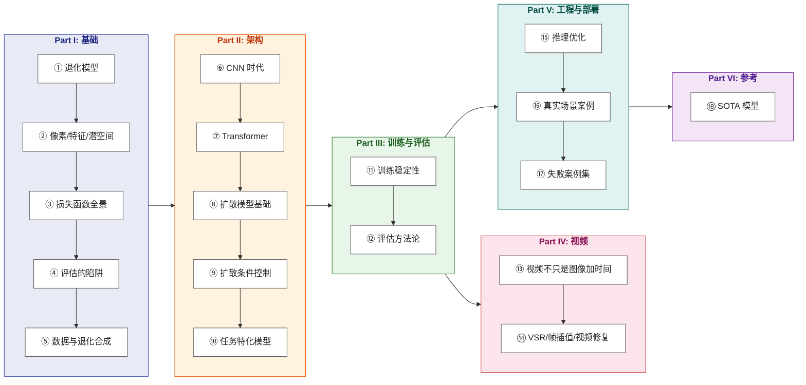

# 影像增强：从原理到工程

> 从退化方程 $y = D(x) + n$ 出发，理解影像增强的第一性原理，掌握从 CNN、Transformer 到扩散模型的完整工程实践。

**Languages**: [中文](README.md) | [English](en/README.md)  
**在线阅读**：[yingwang.github.io/image-enhancement-guide](https://yingwang.github.io/image-enhancement-guide/)

面向熟悉 PyTorch、做过 LLM 或图像分类与检测，但还没有系统做过低层视觉（Low-Level Vision）的工程师。

光线穿过镜头、落在感光元件上，再被量化和压缩保存，每一步都在丢失信息。从信息论来看，所谓“增强”并不是把丢失的原始信号无损找回，而是在无数种可能产生当前退化画面的高清图像里，找出一个最符合物理规律与自然图像统计规律的合理估计。

这本书不教你机械地跑通某一个开源项目的训练脚本，而是希望让你看到一张模糊、暗淡或充满噪点的图像时，能立刻做出工程判断：这种退化丢掉了哪个维度的信息？该引入什么样的先验？用哪种损失函数训练、选哪类网络架构，部署到算力受限的端侧芯片时又该砍掉哪里？

## 这本书的逻辑

**核心逻辑**：先理解“图像是怎么变差的”（退化模型与逆问题），再理清“怎么衡量图像变好了”（损失函数与评估陷阱），接着进入不同阶段的网络架构（从 CNN、Transformer 到潜空间扩散模型）与训练方法，最后处理视频的时序一致性问题，并落到服务端与端侧工程部署。

市面上的影像增强资料，要么是只讲单一方法的论文，要么是只讲环境配置和调用命令的开源仓库 README。它们讲了怎么做，却很少讲背后的设计取舍，更少讲模型在真实业务里翻车时到底是哪一条先验假设失效了。这本书想做的，就是把这个领域的工程直觉和设计取舍讲清楚。

## 边界：包括与不包括

- **包括**：
  - **单图复原**：超分辨率（SR）、去噪、去模糊、去压缩伪影、去摩尔纹、低光增强、HDR 重建、去雨去雾。
  - **语义特化**：人脸修复、老照片修复、黑白上色、文档图像增强。
  - **视频增强**：视频超分辨率（VSR）、视频帧插值（VFI）、视频去抖与时序修复。
  - **成像底层**：ISP（图像信号处理器）基础与神经 ISP 增强。

- **不包括**：
  - 纯生成（文生图/文生视频，如 SD / Sora / Veo）
  - 图像编辑（换装、换脸、风格迁移）
  - 3D 重建（NeRF / 3D Gaussian Splatting）
  - 视频理解（动作识别、视频问答、Video-LLM）
  - 传统音视频编码器开发（H.264 / AV1 编码算法优化）
  - 医学影像重建与卫星遥感（只提共性原理，不展开行业专用管线）
  - 硬件 ISP 芯片设计（仅在传感器与低光章节做算法级衔接）

> **判定标准**：有“原始物理信号”作为参照并对其做逆向估计的，归为增强；脱离输入信号、从随机噪声中无中生有的，归为生成。

## 章节目录

### Part I · 基础

| # | 章节 | 核心问题 |
|---|------|---------|
| 1 | [退化模型与逆问题](chapters/01-degradation-model.md) | 增强的本质是不适定逆问题：当信息已经丢失，先验从哪里来？ |
| 2 | [像素、特征、潜空间](chapters/02-representation.md) | 表征空间与计算代价：为什么现代生成式复原都在潜空间工作？ |
| 3 | [损失函数全景](chapters/03-losses.md) | L1/L2、感知损失、对抗损失与扩散损失各自在优化什么，怎么组合？ |
| 4 | [评估的陷阱](chapters/04-metrics.md) | 失真与感知的权衡（Perception-Distortion Tradeoff）：PSNR/SSIM/LPIPS/FID 各自的盲区 |
| 5 | [数据与退化合成](chapters/05-degradation-pipeline.md) | 真实世界的退化从不单一：为什么退化合成管线决定了模型的真实表现上限？ |

### Part II · 架构

| # | 章节 | 核心问题 |
|---|------|---------|
| 6 | [CNN 时代](chapters/06-cnn.md) | 残差学习与结构演进：SRCNN → EDSR → RCAN → RRDB → NAFNet 的设计脉络 |
| 7 | [Transformer 在低层视觉](chapters/07-transformer.md) | 局部窗口与通道自注意力：注意力机制在复原任务中的收益与代价 |
| 8 | [扩散模型基础](chapters/08-diffusion.md) | 从 DDPM 到潜空间扩散：生成式先验如何补回丢失的高频细节？ |
| 9 | [扩散的条件控制](chapters/09-control.md) | ControlNet、SFT 注入、IP-Adapter 与分块推理：在保真与生成之间怎么取舍？ |
| 10 | [任务特化模型](chapters/10-task-specific.md) | 人脸（Codebook/3D）、文档与特定领域：如何把领域先验做成归纳偏置？ |

### Part III · 训练与评估

| # | 章节 | 核心问题 |
|---|------|---------|
| 11 | [训练稳定性](chapters/11-training.md) | 混合精度、GAN 判别器失稳、扩散采样调度与混合损失权重调优 |
| 12 | [评估方法论](chapters/12-evaluation.md) | 客观指标的局限、主观评测（MOS/2AFC）设计与统计显著性检验 |

### Part IV · 视频

| # | 章节 | 核心问题 |
|---|------|---------|
| 13 | [视频增强不是图像加时间](chapters/13-video-basics.md) | 时序一致性与闪烁问题：光流对齐与可形变卷积（DCN）在解决什么？ |
| 14 | [VSR / 帧插值 / 视频修复](chapters/14-video-models.md) | 循环特征传播与双向对齐：从 BasicVSR++、RIFE 到视频生成式复原 |

### Part V · 工程与部署

| # | 章节 | 核心问题 |
|---|------|---------|
| 15 | [推理优化](chapters/15-inference.md) | 算力与精度的权衡：量化（PTQ/QAT）、TensorRT、CoreML 与移动端部署 |
| 16 | [真实场景案例](chapters/16-cases.md) | 五个生产案例：老照片修复、暗光成像、UGC 视频、4K 直播与神经 ISP |
| 17 | [失败案例集](chapters/17-failures.md) | 生产环境中的 15 种典型翻车：过平滑、幻觉编造、接缝伪影与时序闪烁排查 |

### Part VI · 参考

| # | 章节 | 核心问题 |
|---|------|---------|
| 18 | [SOTA 模型](chapters/18-sota.md) | 2026 前沿主线：MambaIR、全能复原、DiT 架构与少步/单步扩散复原 |

## 与其他几本的关系

| | [LLM 训练指南](https://github.com/yingwang/llm-tutorial) | [Thinking in LLM](https://github.com/yingwang/thinking-in-llm) | 影像增强（本书） |
|---|---|---|---|
| **领域** | LLM 训练与微调 | LLM 应用与系统构建 | 低层视觉与图像/视频复原 |
| **形态** | 工程指南 + 代码库 | 第一性原理与思维模型 | 原理剖析 + 工程实践（含代码片段） |
| **读者** | 训练工程师与 Infra | LLM 应用/产品工程师 | 影像处理 / 视觉算法工程师 |
| **前置要求** | 机器学习基础 | 基础编程经验 | PyTorch + 基础机器学习知识 |

## 如何阅读

- **从头到尾读**：按 Part I → VI 的顺序推进。第 1 章是全书的地基，建议无论如何先读。
- **赶时间**：读第 1 章（中心方程与逆问题）→ 第 5 章（退化合成）→ 第 8 章（扩散基础）→ 第 18 章（当前最强模型），快速建立整体框架。
- **已有大模型/高层视觉背景**：跳到第 7-9 章看注意力和扩散在低层视觉里的具体形态，按需回查 Part I 的损失和评估。
- **做产品与工程落地**：直接读第 15-17 章（推理优化、真实场景案例、失败案例集），遇到陌生概念再往前查。

## 作者

Ying Wang

## 许可证

本仓库采用**双重许可**：

- **正文与示意图**（Mermaid 图、解释性文字、章节内容）：[CC BY-NC-SA 4.0](LICENSE)（署名 · 非商业 · 相同方式共享）
- **代码片段**（章节中的 Python 示例）：[MIT](LICENSE-CODE)（自由使用，含商业用途，仅需保留版权声明）

---

> 最后更新: 2026-08
