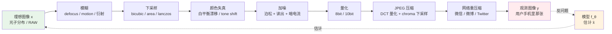
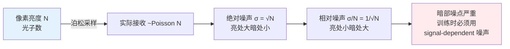

# 第 1 章 · 退化模型与逆问题

> “增强”是一种通俗说法。本书用更准确的词：**估计**。

## 1.0 阅读须知

本书面向有一定机器学习基础、但未必专门做过低层视觉的算法工程师。预设读者具备以下背景：

- 熟悉张量计算，能流畅阅读 PyTorch 代码，了解卷积、上采样、归一化、注意力等基本算子的作用
- 看得懂常见的损失函数表达式与梯度下降流程
- 听说过扩散模型，但不一定亲手训练过

本书不预设的背景包括：图像信号处理（ISP）、信号采样与混叠的频域理论、视频编码标准、传感器物理模型，以及特定低层视觉模型的细节。每个第一次出现的术语，书中都会先用一两句话解释清楚，再展开使用。

**记号约定。** 全书统一使用以下数学符号：

- $x$：理想的高质量图像（high-quality / ground truth），张量形状一般写作 $(C, H, W)$，$C$ 是颜色通道数，$H, W$ 是高宽
- $y$：观测到的低质量图像（low-quality / observed），形状可能与 $x$ 不同（例如超分辨率任务下 $y$ 比 $x$ 小）
- $\hat{x}$：模型对 $x$ 的估计
- $D$：退化算子（degradation operator），即把高质量图像变成低质量图像的过程（本书个别章节会在局部借用同一个字母表示其他对象，例如第 3 章的判别器也记作 $D$，届时会在该处显式说明，不与这里的退化算子混淆）
- $n$：噪声
- $f_\theta$：参数为 $\theta$ 的模型
- $p(\cdot)$：概率分布

**首次出现的缩写。** 为避免阅读中途被术语打断，本书在缩写首次出现时会在括号里给出全称与简要定义：

- **ISP**（Image Signal Processor，图像信号处理器）：相机内部把传感器原始读数转换为可见图像的整套流水线
- **ISO**：传感器的感光度等级，数值越大，信号放大倍率越高，噪声也越明显
- **DCT**（Discrete Cosine Transform，离散余弦变换）：JPEG 压缩里把 8×8 像素块变换到频域的步骤
- **HR / LR**（High Resolution / Low Resolution，高/低分辨率）
- **SR**（Super-Resolution，超分辨率）：把低分辨率图像上采样到高分辨率的任务族
- **IQA**（Image Quality Assessment，图像质量评估）

更多专有缩写将在对应章节出现时再展开。

## 1.1 一个具体的场景

晚上九点，你在街上举起手机拍了一张霓虹灯下的招牌。回家点开大图一看，画面有这些问题：

- 整体偏暗，亮部过曝、暗部死黑
- 字的边缘糊成一团
- 阴影里布满一颗颗紫绿色的小点（噪点）
- 招牌的细线纹路上有奇怪的彩色波纹（摩尔纹 + JPEG 块效应）

你在修图 App 里点了一下“AI 增强”，三秒后画面清楚了不少。

这一节要回答的问题是：这三秒里，模型到底在做什么？

它并不是“找回了原本的画面”。从信息论来看，原本的画面在按下快门、经过压缩的那一刻就已经永远丢失了。模型真正做的，是根据手头这张退化图，去估计一张最可能产生它的高质量图像。这是本书第一个反直觉的结论：

> 增强模型不在“恢复”，它在“猜”。差别只在于猜得有多合理。

理解了这一点，后面所有关于网络架构、损失函数、评估指标与数据合成的设计取舍，就都有了共同的出发点。

## 1.2 中心方程

把上面这件事写成数学形式：

$$
y = D(x) + n
$$

- $x$：理想的高质量图像（你晚上本来希望拍到的那张）
- $D$：退化算子（光线、镜头、传感器、ISP 与压缩算法共同作用的退化过程）
- $n$：噪声（随机扰动，主要来自传感器）
- $y$：你手里这张实际拍到的退化图像

整本书围绕的事情只有一件：给定 $y$，估计 $x$。

记作 $\hat{x} = f_\theta(y)$，其中 $f_\theta$ 是我们要训练的模型，参数是 $\theta$。

这个看似简单的方程，浓缩了低层视觉领域的核心工程难题：

1. $D$ 通常**未知**（拍照时你并不知道镜头有多脏、传感器温度多高、JPEG 压缩质量参数是多少）
2. $D$ 是**多对一**映射（无穷多张不同的 $x$ 经过 $D$ 都能产生同一张 $y$）
3. $n$ 是**随机的**（同一张 $x$ 加上不同的噪声实现 $n$，会得到不同的 $y$）
4. 数据集里通常**只有 $y$，没有 $x$**（真实低质量图与真实高质量图严格对齐的成对数据极少）

第 1、2 点决定了这是一个**逆问题**（inverse problem），第 3 点说明它是一个**统计逆问题**，第 4 点则决定了训练时往往必须自己合成 $(x, y)$ 配对数据，这也是第 5 章退化合成要解决的问题。

## 1.3 为什么这是 ill-posed 问题

数学上用三个条件来定义一个适定（well-posed）问题：

1. **解存在**
2. **解唯一**
3. **解对输入连续依赖**（输入发生微小扰动时，输出也只发生微小变化）

逆问题往往三条都不满足，因此称为**不适定问题**（ill-posed problem）。影像增强就是典型的不适定问题。

看一个最直观的例子：4 倍下采样的超分辨率。

假设你有一张 $512 \times 512$ 的低分辨率图 $y$，要恢复成 $2048 \times 2048$ 的高分辨率图 $x$。这意味着原图里每 $4 \times 4 = 16$ 个像素，都被某种方式压缩成了 $y$ 里的 1 个像素。

具体是怎么压的？先看最简单的 box（区域均值）下采样：把每个 $4 \times 4$ 的高分辨率像素块直接取算术平均，得到 $y$ 里的一个像素。这是一个从 16 维空间到 1 维空间的映射，16 维降到 1 维，直接丢掉了 15 维信息。（工程上更常用的 bicubic 下采样略有不同：它的插值核支撑区大于 $4 \times 4$，而且带有负瓣，并不会把某个 $4 \times 4$ 块孤立地压成一个值。这里用 box 均值举例，是为了把“丢掉多少维”这笔账算清楚；至于维度坍缩、信息不可逆丢失这一点，两种下采样是一致的。）

反过来想，给你这一个像素值 $y_{ij}$，问哪些 $4 \times 4$ 的高分辨率块能产生它？答案是一个 15 维的解空间，里面有无穷多个合法的高分辨率块。

不妨考虑一个具体的低分辨率像素 $y_{ij} = 128$（中等灰度）：

- 它可能是一块均匀灰色（高分辨率块 16 个像素全是 128）
- 也可能是黑白条纹（一半是 1，一半是 255，平均值仍是 128）
- 也可能是一段平滑斜坡（从 100 渐变到 156）
- 也可能是中间有一个亮点（例如 15 个 120 加上 1 个 248，平均值同样是 128）

所有这些截然不同的高分辨率块，经过均值下采样都会得到同一个 128。模型必须从中选出一个作为输出，那到底该选哪一个？

这就是**先验**（prior）发挥作用的地方。

## 1.4 三种“先验”

先验就是关于“自然图像应该长什么样”的假设。一个优秀的增强模型，本质上是把合理的图像先验编码进了网络的归纳偏置或训练数据里。

从发展脉络来看，先验主要有三种来源：

### 解析先验（手工设计）

早期研究者根据观察总结出自然图像的统计规律，直接写成数学正则项。最经典的有几类：

- **平滑性**：相邻像素值通常相近（用梯度的 L2 范数惩罚）
- **稀疏梯度**（Total Variation）：自然图像在大多数平坦区域梯度接近零，只在少数边缘处梯度很大（用梯度的 L1 范数惩罚）
- **小波/DCT 稀疏性**：自然图像变换到小波域或 DCT 域后系数是稀疏的

这一类方法的代表是 20 世纪 90 年代到 2010 年前后主导该领域的**变分方法**与**稀疏编码**。它们简洁、可解释，也不需要训练，但效果上限很低。原因在于手工先验太弱，没法表达“这块区域是人脸皮肤还是猫毛”这类与具体内容高度相关的结构知识。

今天我们已经不用这类方法做主力模型，但它们的思想仍然保留在训练目标里，比如第 3 章会讲到的 TV 损失：

```python
def total_variation_loss(x: torch.Tensor) -> torch.Tensor:
    """Total Variation：惩罚相邻像素差，鼓励分段平滑。
    x: (B, C, H, W)
    """
    dh = (x[:, :, 1:, :] - x[:, :, :-1, :]).abs().mean()
    dw = (x[:, :, :, 1:] - x[:, :, :, :-1]).abs().mean()
    return dh + dw
```

### 数据驱动先验（CNN/Transformer 学到的）

2014 年 **SRCNN**（Super-Resolution Convolutional Neural Network，用三层卷积做超分辨率的开创性工作）出现后，深度学习迅速取代了传统变分方法。卷积神经网络端到端地把 $y$ 映射到 $\hat{x}$，先验隐式地编码在网络权重里。模型在大量自然图像配对 $(x, y)$ 上训练，学到的是自然图像分布在权重空间里对应的低维流形。

这一类方法属于**判别式**（discriminative，即给定输入直接输出确定的估计结果）：给一个 $y$，模型就输出一个确定的 $\hat{x}$。它不显式建模分布 $p(x)$，但在大规模数据集上训练后，输出的 $\hat{x}$ 会自然落在自然图像流形附近。

代表模型包括：

- **SRCNN**（2014，三层卷积）
- **EDSR**（Enhanced Deep Super-Resolution，2017，去掉 BatchNorm 的深度残差网络）
- **RCAN**（Residual Channel Attention Network，2018，把通道注意力引入超分辨率）
- **SwinIR**（Swin Transformer for Image Restoration，2021，把局部窗口注意力引入低层视觉）
- **Restormer**（2022，用通道维自注意力支持高分辨率复原）
- **NAFNet**（Non-linear Activation Free Network，2022，用简单门控乘法替代非线性激活函数的极简结构）

第 6、7 章会逐一拆解这些架构。

### 生成式先验（扩散模型）

2020 年 **DDPM**（Denoising Diffusion Probabilistic Model，去噪扩散概率模型）成熟之后，生成模型开始显式地建模图像分布 $p(x)$。给定退化图 $y$，我们可以构建条件分布 $p(x \mid y)$，并从中采样出 $\hat{x}$。

这就是**生成式**（generative）路线。它和判别式路线的本质区别在于：

- 判别式回答“最可能的单个 $\hat{x}$ 是什么”，只产出一个确定答案
- 生成式回答“条件分布 $p(x \mid y)$ 长什么样”，可以从中采样出多个合理的答案

生成式方法的优势很明显：在退化极严重、解空间极大的场景下（例如 8 倍超分、人脸高度模糊），判别式模型只能保守地输出一张模糊的“平均脸”，而生成式模型能给出毛孔、发丝等高频细节完整的具体人脸。

它的代价也很直接：它会**编造细节**。这引出了本书反复强调的一条工程原则（第 10、17 章会详细展开）：

> 增强模型在生成细节，而不是恢复细节。
>
> 用扩散模型修复家庭老照片，效果可以很惊艳；用扩散模型修复法医物证或监控车牌，则是严重的工程事故。

## 1.5 退化算子 D 的解剖

回到中心方程 $y = D(x) + n$。在真实世界里，$D$ 从来不是一个单一算子，而是一长串退化过程的复合：

$$
D = \text{JPEG} \circ \text{Quantization} \circ \text{Downsample} \circ \text{Blur} \circ \text{ColorShift} \circ \text{LensDistortion} \circ \dots
$$

而且这串复合算子本身带有随机性，同一台手机在不同时刻拍同一个场景，历经的退化参数也不会完全相同。

工程上我们最关心的 $D$ 组件有以下几类：

### 模糊（Blur）

模糊在数学上可以表示为图像与某个模糊核 $k$ 的卷积：$y = x * k$。

不同的物理成因对应不同形态的模糊核：

- **散焦模糊**（defocus）：核接近圆盘形（盘状散焦斑），半径取决于失焦程度与光圈大小
- **运动模糊**（motion blur）：核近似一条线段或轨迹，长度和方向取决于曝光期间相机或物体的相对运动
- **大气模糊**（atmospheric）：核接近高斯分布，方差取决于大气湍流强度
- **镜头衍射 / 像差**：核表现为 Airy 斑或更复杂的非对称点扩散函数（PSF）

真实照片往往叠加了不止一种模糊，而且模糊核在空间上还会变化（画面中心与边缘的镜头像差不同，前景与背景的运动速度也不同）。正因为真实模糊核通常未知，才有了**盲去模糊**（blind deblur）这个专门的研究方向。

### 下采样（Downsample）

下采样把高分辨率图像缩成低分辨率图像。常见插值算法有：

- **Nearest**：直接取最近邻像素。计算最快、画质最差，会产生明显锯齿
- **Bilinear**：双线性插值，对 2×2 邻域做加权平均
- **Bicubic**：双三次插值，对 4×4 邻域做加权平均，是学术界超分辨率数据集事实上的标准下采样方式
- **Lanczos**：基于 sinc 函数的截断窗口滤波，频域响应更接近理想低通滤波器
- **Box / Average**：把对应的高分辨率像素块做简单算术平均

不同下采样算法的频域特性差别很大。Bicubic 在理论上性质规整，但在工程上隐藏着一个大坑：它假设输入图像本身没有混叠（aliasing-free），而真实相机拍出来的图像几乎都带有不同程度的混叠和传感器噪声。用纯 bicubic 下采样合成训练数据，就会造成 1.6 与 1.7 节要讲的“训练-推理失配”。

```python
import torch
import torch.nn.functional as F

def downsample_compare(x: torch.Tensor, scale: int = 4):
    """对同一张图用不同方法下采样,看差异。
    x: (1, C, H, W), 值域 [0, 1]
    """
    h, w = x.shape[-2:]
    new_h, new_w = h // scale, w // scale

    nearest  = F.interpolate(x, size=(new_h, new_w), mode='nearest')
    bilinear = F.interpolate(x, size=(new_h, new_w), mode='bilinear', align_corners=False)
    bicubic  = F.interpolate(x, size=(new_h, new_w), mode='bicubic',  align_corners=False)
    area     = F.interpolate(x, size=(new_h, new_w), mode='area')  # 等价于 box filter

    return {
        'nearest':  nearest,
        'bilinear': bilinear,
        'bicubic':  bicubic,
        'area':     area,
    }
```

动手跑一下就会发现，bicubic 在视觉上最锐利，area（box）最柔和，nearest 则满是锯齿。没有哪个下采样算法是唯一“正确”的，它们各自对应着不同的物理或软件重采样过程。

### 噪声（Noise）

噪声是最容易被简化成一行高斯白噪声、却最值得深挖的环节。1.8 节会专门拆解它的物理来源。

### 压缩伪影（Compression Artifacts）

JPEG 是静态图像最普遍的压缩格式，它的标准流程分为五步：

1. 将 RGB 转换到 YCbCr 颜色空间，并对色度通道做下采样（chroma subsampling）
2. 将图像切分为 8×8 像素块
3. 对每个 8×8 块做 DCT（离散余弦变换）
4. 对 DCT 系数做除以量化表的取整量化（quality 越低，量化步长越粗）
5. 对量化后的系数做熵编码

其中第 4 步量化和第 1 步色度下采样是有损操作，解码重建后会留下三种典型伪影：

- **块状伪影**（blocking artifacts）：8×8 块的边界出现肉眼可见的阶梯断裂
- **振铃伪影**（ringing）：高对比度边缘附近出现高频振荡波纹
- **彩色失真**：色度下采样导致边缘处出现溢色或彩边

视频压缩（H.264 / H.265 / AV1）的原理类似，但引入了帧间预测与运动补偿，伪影还会顺着运动轨迹在帧与帧之间拖拽。

### 颜色失真

白平衡漂移、色彩衰减、低光下的色温偏移都属于颜色失真。这类退化在数学上主要不是空间邻域的混合，而是像素值域上的非线性映射与通道耦合。

### 复合退化链的数据流图

把上面这些环节串起来，从光子落到传感器，一直到用户手机相册里那张模糊照片，完整的退化链路可以画成下面这张图。后续章节讨论任何模型时，都可以在脑海里对照这张图：你的模型要做的，就是把下面这条链路尽可能逆向推回去。



从这张图可以引出四条直接影响工程设计的结论：

1. **顺序并不固定**：真实世界里各个退化环节的先后顺序随时可能调换，比如一张图可能先被截图缩放、再调色、再压 JPEG，也可能反复经历多次缩放与重压缩。
2. **每一步都带随机性**：同一张原图经过两台同型号手机拍摄，输出也不会完全相同，因为光子到达的随机性、温度噪声和压缩量化截断每次都在变化。
3. **靠后的步骤往往直接主导观感**：压缩块效应和传感器噪点会直接拉低 PSNR，而早期的光学模糊与下采样则决定了画面的主观锐度上限。
4. **模型学的不是逐步逆运算**：端到端模型 $f_\theta$ 学的是整条复合退化链的联合逆映射，而不是按顺序一步步反演。这也是端到端方法在真实场景下普遍优于传统分步串联方案的根本原因。

## 1.6 Blind vs non-blind：D 已知还是未知

回到中心方程 $y = D(x) + n$。初学者常把两类设定混为一谈：推理时退化算子 $D$ 究竟是已知的还是未知的？这两种设定的工程做法截然不同。本书后续章节默认讨论 blind（盲复原）设定，但这里先把两者的边界划清。

### Non-blind：D 已知

经典图像复原往往假设 $D$ 已知或可预先标定：

- **去运动模糊**：相机记录了曝光期间的陀螺仪（IMU）轨迹，从而可以解析算出模糊核 $k$
- **医疗 CT 重建**：扫描仪与探测器的几何结构固定，系统投影矩阵 $A$ 已知
- **去摩尔纹**：翻拍屏幕时如果已知屏幕像素排列与分辨率，混叠模型就可以预先建模
- **传感器去噪**：已知传感器型号、ISO 和曝光时间时，噪声分布（泊松光子噪声 + 高斯读出噪声 + 暗电流）的参数可以直接查表得到

非盲场景可以使用经典的解析反演或迭代正则化方法（如 Wiener 滤波、Richardson-Lucy、TV 正则、Plug-and-Play ADMM），也可以用深度学习方法，把已知的退化参数（如模糊核、噪声水平图）作为条件输入一并喂给网络（如 SRMD、USRNet 等）。

### Blind：D 未知

而在绝大多数真实产品场景里，$D$ 是未知的：

- 用户从手机相册上传一张图，系统无从知道它是由哪款镜头拍摄、经过哪套 ISP 处理的
- 网络图片不知道被社交平台转存、缩放和重压缩了多少轮
- 老照片经历了数十年的化学褪色、霉斑和折痕，不存在简单的解析退化公式
- 屏幕截图混合了字体渲染、非整数倍缩放与有损压缩

在 blind 场景下，你没法在推理前拿到精确的 $D$，工程上只能靠两条路径应对：

1. 在训练阶段让模型见过足够宽广的合成退化分布（Real-ESRGAN 的二阶退化管线就是这一路线的代表，第 5 章详谈）
2. 在推理阶段显式或隐式地估计退化特征（例如 KernelGAN 估计模糊核，DASR 学习退化表征，或者像 SUPIR 那样用多模态大模型生成描述退化与语义的文本条件）

### 为什么这个区分重要

本书后续讨论的代表性模型与指标在 blind / non-blind 谱系上的位置如下：

| 模型 | 范式 | $D$ 处理方式 |
|------|------|------------|
| Real-ESRGAN | **Blind SR** | 训练时遍历百余种合成退化组合 |
| CodeFormer | **Blind face restoration** | 用离散 codebook 提供人脸结构先验，绕开显式估计 $D$ |
| BSRGAN | **Blind SR** | 与 Real-ESRGAN 同期，采用随机打乱顺序的退化合成路线 |
| MANIQA / CLIP-IQA / Q-Align | **Blind IQA**（NR-IQA） | 无需参考真值图，直接对单张图像的质量打分 |
| SUPIR | **Blind**（含 LLaVA prompt） | 靠大规模退化合成训练，并用文本提示补充语义上下文 |
| Restormer | **可 blind 可 non-blind** | 网络结构本身不依赖 $D$，行为取决于训练数据配对方式 |
| OSEDiff / TSD-SR | **Blind SR** | 将盲超分扩散模型蒸馏到单步或少步推理 |

工程上的结论很明确：生产环境里凡是面向“用户上传图片”的产品，几乎都只能按 blind 范式设计。任何强依赖已知 $D$ 的算法，哪怕在实验室标准测试集上指标再高，搬到线上都必须先加一级退化参数估计，而参数估计本身又是不适定问题，一旦估偏就会引起严重的振铃或伪影。

序章里说的“看到一张退化图就能判断怎么处理”，落到工程上就是如何在 $D$ 未知的前提下挑选合适的先验、数据管线与控制方式。这条线索会贯穿全书。

### Blind IQA：评估侧的对应概念

第 4 章会系统讨论评估指标，这里先点出与 blind 复原直接对应的评估分类。图像质量评估指标同样分为**全参考**（Full-Reference，FR）与**无参考**（No-Reference，NR，也叫 blind IQA）两类：

- **FR-IQA**（Full-Reference Image Quality Assessment）：把模型输出 $\hat{x}$ 与真值 $x$ 配对比较打分。代表指标有 **PSNR**（Peak Signal-to-Noise Ratio，峰值信噪比）、**SSIM**（Structural Similarity，结构相似度）、**LPIPS**（Learned Perceptual Image Patch Similarity，深度特征感知距离）和 **DISTS**（Deep Image Structure and Texture Similarity，结构与纹理分离的感知相似度）。这类指标必须要有高清真值 $x$。
- **NR-IQA**（No-Reference / Blind IQA）：没有参考真值，只看输出图像 $\hat{x}$ 自身给出质量分。代表指标有 **NIQE**（Natural Image Quality Evaluator，基于自然图像统计特征的无参考指标）、**MANIQA**（Multi-dimension Attention Network for IQA）、**CLIP-IQA**（利用 CLIP 图文对齐空间做质量评估）和 **Q-Align**（基于多模态大模型的质量评分）。

在生产环境里，用户上传的退化图没有对应的“高清原图”，因此线上质量监控和自动路由只能依赖 NR-IQA。

## 1.7 真实世界退化与训练-推理失配

把 1.5 节的各个环节串起来，你晚上用手机拍下并传给朋友的一张照片，大致经历了这样一条链路：

$$
y = \text{NetworkRecompression}(\text{JPEG}(\text{Quantize}(\text{ISP}(\text{Sensor}(x_{\text{photon}})))))
$$

其中：

- $x_{\text{photon}}$ 是落到传感器表面的光子分布（这才是物理意义上的原始信号）
- $\text{Sensor}$ 把光子转换为电信号，同时引入光子散粒噪声、读出噪声和暗电流
- $\text{ISP}$ 是手机芯片内的图像信号处理器，负责去马赛克（demosaicing）、降噪、白平衡、局部色调映射（tone mapping）与色彩校正矩阵
- $\text{Quantize}$ 将连续或高位宽信号量化为 8 位整数（部分格式为 10-12 位）
- $\text{JPEG}$ 是相册保存时的第一次有损压缩
- $\text{NetworkRecompression}$ 是图片经过微信、微博或 Twitter 等社交软件发送时经历的二次缩放与重压缩

这条长链路才是真实世界里的退化算子 $D$。

然而在过去十多年里，包括 SRCNN、EDSR、RCAN、ESRGAN、SwinIR 在内的大多数学术论文，训练数据都是用一行极度简化的代码合成的：

```python
# 学术论文的"经典"训练对合成
y = bicubic_downsample(x, scale=4)   # 完了
```

这就是低层视觉领域在 2014-2020 年间最突出的**训练-推理失配**（train-test mismatch）：

- **训练阶段**：模型见到的输入 $y$，全是由干净高分辨率图直接做理想 bicubic 下采样得到的
- **推理阶段**：模型面对的输入 $y$，却是带着传感器噪点、ISP 锐化痕迹、JPEG 块效应与社交平台重压缩的真实图片

因为训练时见过的退化分布与真实图片毫无交集，直接导致了两个后果：

- EDSR、RCAN 这类以 PSNR 为导向的模型，在 Set5、Set14 等合成测试集上能刷到 30 dB 以上的漂亮数字
- 一旦把这批模型（连同为了追求视觉锐度而主动牺牲几分贝 PSNR 的原始 ESRGAN）搬到手机实拍照片上，效果就会大打折扣；原始 ESRGAN 尤其明显，往往会把暗部噪点和压缩边缘当成真实高频信号去放大，生成一层像塑料糖纸一样的伪影

这一失配困扰了业界五六年，直到 2021 年 **Real-ESRGAN** 和 **BSRGAN** 出现才得到系统解决。Real-ESRGAN 最核心的贡献并不是改了网络结构（它的生成器依然沿用 ESRGAN 的 RRDB 网络），而是设计了一套贴近真实世界的**高阶退化合成管线**：

```python
# Real-ESRGAN 风格的退化(简化版,真实代码在第 5 章详讲)
y = x.clone()
y = apply_blur(y, kernel=random_blur_kernel())      # 模糊
y = downsample(y, scale=random_scale(), mode=random_mode())  # 多种下采样
y = add_noise(y, type=random_noise_type())          # 高斯+泊松+真实传感器噪声
y = jpeg_compress(y, quality=random.randint(40, 95))  # JPEG
# 关键: 整个流程做两遍 (second-order degradation)
y = apply_blur(y, ...); y = downsample(y, ...); y = add_noise(y, ...); y = jpeg_compress(y, ...)
```

管线里的每一步都在模拟真实退化链上的一个组件，并且把整套流程串联执行两遍（二阶退化）。完全相同的 RRDB 网络，换用这套数据管线训练后，在真实照片上的表现发生了质变，成为 2021 年低层视觉领域的分水岭。

这里可以记住一条贯穿全书的经验：

> 在影像增强领域，“数据合成管线”往往比“网络结构微调”更能决定真实场景的效果上限。
>
> 同一个网络，用单一 bicubic 数据训出来无法上生产，换成覆盖真实退化分布的数据管线就能直接可用。

第 5 章会完整拆解这套退化合成管线的工程细节。

## 1.8 噪声深挖：为什么不是高斯

很多入门教程和早期论文在给图像加噪时，只写一行同方差高斯白噪声：

```python
y = x + torch.randn_like(x) * sigma
```

这其实是对真实相机成像过程的过度简化。真实传感器的噪声主要来自两个物理环节：

### 光子噪声（shot noise）

光子到达像素感光井是一个离散的**泊松过程**。如果某个像素在曝光时间内平均接收 $N$ 个光子，那么实际接收到的光子数服从泊松分布 $\text{Poisson}(N)$，其方差恰好等于均值 $N$，标准差为 $\sqrt{N}$。

这个关键性质意味着：画面亮处光子多，噪声的**绝对涨落幅度**大；画面暗处光子少，噪声的绝对涨落幅度小。但人眼和后续增益放大感知到的是**信噪比**（SNR）：

$$
\text{SNR} = \frac{N}{\sqrt{N}} = \sqrt{N}
$$

亮处 $N$ 大，信噪比高，画面看起来干净；暗处 $N$ 小，相对噪声 $\sigma / N = 1/\sqrt{N}$ 反而很大。这就是为什么夜景照片的阴影和暗部总是噪点最重的地方。

如果把像素亮度（光子数 $N$）作为横轴、噪声标准差 $\sigma$ 作为纵轴，泊松光子噪声给出的是 $\sigma = \sqrt{N}$ 的平方根曲线；而传统的同方差高斯噪声假设无论亮暗都加同样的 $\sigma$，在图上只是一条水平直线。



### 读出噪声（read noise）

感光井把电荷转成电压，再经过放大器与模数转换器（ADC）量化，电路本身会引入热噪声与量化噪声。这一部分噪声与进了多少光子无关，近似服从均值为 0、标准差为常数 $\sigma_r$ 的高斯分布。

### 真实模型：信号相关高斯（泊松-高斯混合）

把光子散粒噪声的高斯近似与读出噪声合在一起，就得到了**异方差高斯噪声模型**（heteroscedastic Gaussian）：

$$
y = x + \mathcal{N}(0, a \cdot x + b)
$$

其中 $a$ 控制与信号亮度成正比的光子噪声项，$b$ 控制与信号无关的读出噪声方差。$a, b$ 由传感器物理特性和当前 ISO 增益共同决定。

```python
import torch

def heteroscedastic_noise(
    x: torch.Tensor,
    a: float = 0.01,
    b: float = 0.001,
) -> torch.Tensor:
    """信号相关的高斯噪声(近似真实传感器)。
    x: (B, C, H, W), 值域 [0, 1]
    a: 光子噪声系数 (signal-dependent)
    b: 读出噪声方差 (signal-independent)
    返回: 加噪后的 y, 仍在 [0, 1]
    """
    variance = a * x + b
    sigma = variance.clamp(min=1e-8).sqrt()
    noise = torch.randn_like(x) * sigma
    return (x + noise).clamp(0.0, 1.0)
```

如果不想做高斯近似，也可以直接对信号做泊松采样再叠加高斯读出噪声：

```python
def poisson_gaussian_noise(
    x: torch.Tensor,
    photon_scale: float = 1000.0,  # 越小越暗,噪声相对越大
    read_sigma: float = 0.005,
) -> torch.Tensor:
    """泊松+高斯,真实传感器物理模型。
    photon_scale 模拟曝光,值越小代表暗光场景。
    """
    # 把信号缩放到光子数量级,采样泊松,再缩回来
    photons = x * photon_scale
    noisy_photons = torch.poisson(photons.clamp(min=0))
    shot = noisy_photons / photon_scale
    # 加读出噪声
    read = torch.randn_like(x) * read_sigma
    return (shot + read).clamp(0.0, 1.0)
```

区分这两种噪声模型对工程训练有直接影响：

- 只用同方差高斯白噪声训出来的去噪模型，放到真实手机暗光照片上往往去不干净暗部噪点，或者把亮部细节过度抹平
- 真实照片要求模型在暗部做更强的平滑去噪，在亮部则保守地保留纹理细节，只有用信号相关噪声（泊松-高斯）训练的模型才能学会这种自适应权衡

这也是 SIDD、DND 等真实去噪数据集诞生的原因：研究者干脆用真实相机在受控环境下拍摄“高 ISO 短曝光噪点图与低 ISO 长曝光干净图”配对，绕开合成失配。由于采集真实配对成本高、场景有限，实际工程中最常用的做法是先用泊松-高斯物理噪声模型合成大规模数据预训练，再用少量真实配对数据微调。

## 1.9 简化的 Degradation 类（不含 JPEG）

最后，我们把本章讲到的退化环节组装成一个 Real-ESRGAN 风格的退化合成类骨架。为了保持代码简短易读，这里先省略 JPEG 压缩步骤（GPU 上的可微 JPEG 需要借助 `DiffJPEG`，将在第 5 章给出完整实现），只保留模糊、下采样与噪声三步。

```python
import random
import torch
import torch.nn.functional as F


class SimpleDegradation:
    """Real-ESRGAN 风格的简化退化合成。
    输入高分辨率干净图 x, 输出低分辨率烂图 y。

    完整的 D = JPEG ∘ Noise ∘ Downsample ∘ Blur
    每个组件参数都随机化, 模拟真实世界 D 的不确定性。
    """

    def __init__(self, scale: int = 4):
        self.scale = scale

    # --- 1. 模糊 ---
    def random_blur(self, x: torch.Tensor) -> torch.Tensor:
        """随机选择高斯模糊核。"""
        ksize = random.choice([7, 9, 11, 13, 15])
        sigma = random.uniform(0.2, 3.0)
        kernel = self._gaussian_kernel(ksize, sigma).to(x)
        kernel = kernel.expand(x.shape[1], 1, ksize, ksize)
        pad = ksize // 2
        return F.conv2d(F.pad(x, [pad]*4, mode='reflect'),
                        kernel, groups=x.shape[1])

    @staticmethod
    def _gaussian_kernel(ksize: int, sigma: float) -> torch.Tensor:
        ax = torch.arange(ksize) - ksize // 2
        gauss = torch.exp(-(ax ** 2) / (2 * sigma ** 2))
        kernel = gauss[:, None] * gauss[None, :]
        kernel = kernel / kernel.sum()
        return kernel.unsqueeze(0).unsqueeze(0)

    # --- 2. 下采样 ---
    def random_downsample(self, x: torch.Tensor) -> torch.Tensor:
        h, w = x.shape[-2:]
        new_h, new_w = h // self.scale, w // self.scale
        mode = random.choice(['bilinear', 'bicubic', 'area'])
        kw = {'mode': mode}
        if mode in ('bilinear', 'bicubic'):
            kw['align_corners'] = False
        return F.interpolate(x, size=(new_h, new_w), **kw)

    # --- 3. 噪声 ---
    def random_noise(self, x: torch.Tensor) -> torch.Tensor:
        """三种噪声各 1/3 概率, 模拟不同传感器/场景。"""
        p = random.random()
        if p < 0.33:
            sigma = random.uniform(0.005, 0.05)
            return (x + torch.randn_like(x) * sigma).clamp(0, 1)
        elif p < 0.66:
            a = random.uniform(0.005, 0.03)
            b = random.uniform(0.001, 0.005)
            sigma = (a * x + b).clamp(min=1e-8).sqrt()
            return (x + torch.randn_like(x) * sigma).clamp(0, 1)
        else:
            scale = random.uniform(50.0, 1000.0)
            photons = (x * scale).clamp(min=0)
            return (torch.poisson(photons) / scale).clamp(0, 1)

    # --- JPEG 在第 5 章用 diffjpeg 实现, 这里省略 ---

    def __call__(self, x: torch.Tensor) -> torch.Tensor:
        """简化退化, 顺序: blur -> downsample -> noise (无 JPEG)。"""
        y = self.random_blur(x)
        y = self.random_downsample(y)
        y = self.random_noise(y)
        return y
```

要升级到生产可用的完整版，还需要补上四块拼图：

- **二阶退化**（second-order degradation）：把上述退化流程串联执行两遍，模拟照片在保存、转发和二次编辑中经历的复合损伤
- **退化顺序随机化**：在最后阶段随机切换缩放、sinc 滤波与 JPEG 压缩的先后顺序
- **GPU 上的 JPEG 模拟**：用 `DiffJPEG` 在张量上直接模拟 8×8 DCT 量化与块效应，避免读写磁盘卡住数据加载
- **更丰富的模糊核族**：加入各向异性高斯核、广义高斯核、plateau 核以及模拟锐化振铃的 sinc 核

第 5 章会把这些组件逐一补齐。

## 1.10 本章小结

把本章的核心脉络收束为七点：

1. **影像增强的本质是逆问题**：已知退化过程 $y = D(x) + n$ 的观测结果 $y$，反向估计原始高清信号 $x$。
2. **它天然是不适定的（ill-posed）**：$D$ 是多对一的有损映射，加上随机噪声 $n$，对应同一个 $y$ 的可行解有无穷多个。
3. **模型靠先验在解空间里做选择**：手工解析先验表达力弱，判别式深度学习先验稳健但倾向于平滑折中，生成式扩散先验细节最丰富但存在编造风险。
4. **真实退化是一条长复合链**：光学模糊、下采样、传感器噪声、量化、JPEG 压缩与网络二次压缩叠加在一起。
5. **训练-推理失配是落地失效的头号原因**：只用理想 bicubic 下采样训练的模型，面对真实手机照片和网图时会严重退化甚至放大伪影。
6. **Real-ESRGAN 的核心突破在于数据合成**：用多核族随机退化与二阶退化管线逼近真实世界的 $D$ 分布。
7. **真实传感器噪声不是同方差高斯**：光子噪声服从泊松分布、方差随信号亮度变化，叠加读出噪声后应建模为泊松-高斯或异方差高斯噪声。

本书接下来的 17 章，其实都在从不同侧面回答同一个问题：如何在不适定逆问题的约束下，估计出最合理的 $\hat{x}$？

- 第 2 章：在哪个表征空间里做这件事（像素空间、特征空间还是潜空间）
- 第 3 章：用什么损失函数定义“合理”
- 第 4 章：用什么指标评估“合理”，以及指标会如何骗人
- 第 5 章：如何系统地合成贴近真实分布的训练数据
- 第 6-10 章：用什么网络架构来承载图像先验
- 第 11-12 章：怎么把模型训稳、把效果评准
- 第 13-14 章：进入视频领域后如何应对时序一致性约束
- 第 15-17 章：如何把模型部署到真实业务场景并排查线上翻车
- 第 18 章：站在 2026 年的节点，当前最值得关注的前沿模型与技术主线

在后续章节读到任何具体技术设计时，都不妨退一步问自己：这个设计是在改进退化 $D$ 的建模、增强图像 $x$ 的先验，还是在优化 $\hat{x}$ 的搜索与采样效率？全书的所有内容都落在这个三角框架之内。

---

> 下一章：[像素、特征、潜空间](02-representation.md)
