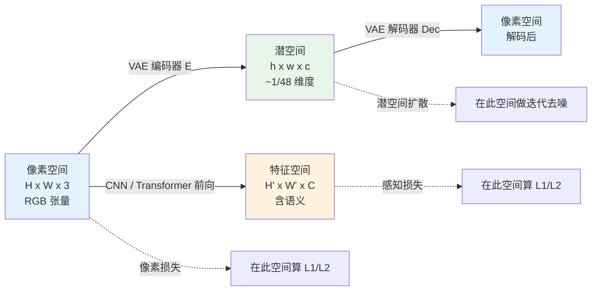
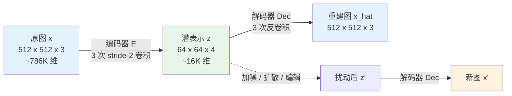

# 第 2 章 · 像素、特征、潜空间

> 这一章回答一个基础问题：增强模型应该在哪个空间里工作？理清这个问题后，你会明白一个看似反直觉的事实：现代增强模型几乎都不会只在像素空间里完成全部工作。

## 2.0 读这一章之前

第 1 章把影像增强定义为不适定的统计逆问题，并指出模型必须依靠先验在解空间里做选择。这一章往前走一步：这个选择究竟发生在**哪个表征空间**里？

一张图像进入神经网络变成张量后，可以有三种截然不同的存在形态：它可以一直是 $(C, H, W)$ 的 RGB 像素张量；可以被卷积或注意力骨干逐层抽象成 $(C', H', W')$ 的中间特征图；也可以被专门训练的编码器压缩成尺寸小得多的 $(c, h, w)$ 潜空间表示。模型可以在其中一个空间做预测，在另一个空间算损失，最后在第三个空间做评估。预测空间与损失空间的组合，决定了整套增强方案的工程骨架。

读完这一章，你应当能清楚回答以下几个问题：

- 为什么直接在 RGB 像素上做 L2 回归看似顺理成章，恢复出来的图却总是发糊
- “感知损失”具体是把张量送到哪里、度量了什么差异
- Stable Diffusion 系列模型为什么在训练扩散网络前要先训一个 VAE
- 同一张退化图在像素空间、感知空间和潜空间里的“距离”为什么排名完全不同
- 读到一篇新的复原论文时，如何从空间选择的角度快速看穿它的设计取舍

本章预设的背景与第 1 章相同：能读懂 PyTorch 代码，了解卷积、上采样和注意力的基本运算。如果你此前没有接触过 VAE（Variational AutoEncoder，变分自编码器），也不用担心，2.4 节会从头搭建一个最小可读示例。

**本章首次出现的缩写。** 第 1 章已经介绍过的 PSNR、SSIM、LPIPS、DISTS、ISP、HR、LR、SR、IQA、SRCNN、EDSR、RCAN、SwinIR、Restormer、NAFNet、DDPM 在此不再重复。本章新增或展开的术语包括：

- **CNN**（Convolutional Neural Network，卷积神经网络）：以二维卷积为核心算子的网络族，是 2014-2020 年间低层视觉的主力架构
- **Transformer**：以自注意力（self-attention）为核心算子的网络族，2021 年后成为低层视觉的重要骨干
- **VGG**：牛津大学 Visual Geometry Group 在 2014 年提出的深层分类网络，因其中间层特征与人眼视觉感知契合度高，被广泛用作感知损失的特征提取器
- **VAE**（Variational AutoEncoder，变分自编码器）：由编码器与解码器组成的生成模型，编码器将图像压缩为近似服从简单先验分布的低维连续潜表示
- **VQ-VAE**（Vector-Quantized VAE）：对潜空间特征做离散码本（codebook）量化的 VAE 变体，将图像编码为离散 token 索引图
- **LDM**（Latent Diffusion Models，潜空间扩散模型）：把扩散加噪与去噪过程从像素空间搬到 VAE 潜空间的范式，是 Stable Diffusion 系列的基础
- **CLIP**（Contrastive Language-Image Pre-training）：OpenAI 于 2021 年发布的图文对比预训练模型，将图像与文本映射到同一语义嵌入空间
- **DINO**：2021 年提出的自监督视觉表征模型，其特征对物体几何结构与语义部位有良好的对应性
- **GAN**（Generative Adversarial Network，生成对抗网络）：通过生成器与判别器对抗博弈来逼近真实数据分布的生成模型
- **FFT**（Fast Fourier Transform，快速傅里叶变换）：将信号从空间域转换到频域的标准算法
- **UNet**：带跨层跳连接（skip connections）的对称编码-解码结构，是扩散模型最经典的去噪骨干
- **SUPIR / StableSR / SeeSR / DiffBIR**：本章会提及的四个代表性潜空间扩散复原模型，具体结构将在第 8-9 章拆解

## 2.1 三种空间

翻开任何一篇现代影像增强论文，它的核心计算都发生在以下三种空间之一或它们的组合中：

| 空间 | 张量形状 | 来源 | 直观含义 |
|------|---------|------|---------|
| 像素空间 | $H \times W \times 3$ | 原始 RGB 图像 | 人眼直接看到的画面 |
| 特征空间 | $H' \times W' \times C$ | CNN / Transformer 中间层 | 深度网络提取的边缘、纹理与语义激活 |
| 潜空间 | $h \times w \times c$（通常 $h = H/8$） | VAE 编码器输出 | 剥离冗余后的紧凑编码表示 |

几乎所有主流增强方法，本质上都在设计这三个空间之间的映射、约束与距离度量。例如：

> SwinIR 在**像素空间**直接输出预测图像；
> 它的感知型变体在训练时引入**特征空间**的感知损失（VGG features）；
> 而 StableSR、SUPIR 等扩散复原模型则直接在**潜空间**做迭代去噪预测。

把握这三个空间的脾气，是理解后续所有架构与损失设计的前提。更进一步看，现代增强工程里有一个非常普遍的现象：模型的**预测**发生在一个空间，**训练损失**在另一个空间计算，而最终的**质量评估**又在第三个空间进行。

比如：
- 一个感知导向的 SwinIR 在像素空间做预测，训练损失混合了像素 L1 与 VGG 特征空间 L1，评估时同时看像素空间的 PSNR 和特征空间的 LPIPS；
- 一个 StableSR 在 VAE 潜空间做去噪预测，损失在潜空间计算，解码回像素空间后则用 PSNR（像素空间）、LPIPS（特征空间）和 FID（特征空间分布散度）来综合评估。

因此，剖析任何一个复原方法的第一步，就是先问清它在“预测、损失、评估”这三个环节各自选了哪个空间。

下面这张图展示了三种空间的转换关系：VAE 的编码器 $E$ 把像素图像压缩为潜表示，解码器 $\mathrm{Dec}$ 再把潜表示还原回像素空间；而预训练的 CNN 或 Transformer 则把像素图像映射为多层特征图，供感知损失或评估指标计算距离。



接下来三节就沿着这张图的三个方框展开：2.2 节剖析为什么不能只停留在像素空间，2.3 节介绍特征空间与感知损失，2.4 节讨论潜空间与潜空间扩散模型（LDM）。

## 2.2 像素空间的三个问题

直接在像素空间预测 $\hat{x} = f_\theta(y)$ 看起来最直观：输入与输出都是 RGB 图像，损失函数直接算逐像素的 L1 或 L2 误差，人眼最终看的也是像素。但只靠像素空间会撞上三个根本问题。

### 问题一：高度冗余

一张 $1024 \times 1024$ 的 RGB 图像包含 $3,145,728$ 个像素值，但自然图像的**内在维度**（intrinsic dimension）远低于这个数字。

你可以做一个简单的思想实验：随机生成三百多万个 $[0, 255]$ 之间的均匀分布整数并排成一张图，你得到的几乎必然是一屏电视雪花噪点，绝不可能是任何自然场景。这说明自然图像在百万维的像素空间里只占据了一个极其稀疏的低维流形。

学术界对自然图像流形的有效维度做过多次经验估计，量级通常在几百到几千维之间。也就是说，一张百万像素图片的独立结构信息，大致只相当于一个几千维的向量，其余绝大多数维度都是高度相关的空间与通道冗余。Stable Diffusion 的 VAE 把 $1024 \times 1024 \times 3$ 的图像压缩成 $128 \times 128 \times 4 = 65,536$ 维，体量比原始像素少了近五十倍，正是利用了这种冗余性。不过也要注意尺度差别：$65,536$ 维依然远高于“几百到几千维”的内在维度估计，因此 VAE 的潜空间并不是无冗余的最小流形坐标，它仍然保留了相当多的空间排布结构，只是一种比原始像素紧凑得多的有损工程表征。

像素空间的高度冗余会带来两个直接的工程后果：

1. **绝大多数像素组合毫无意义**：模型在三百万维的空间里做预测，必须学会避开 99.999% 以上的非自然图像区域。
2. **计算资源花在重复信息上**：相邻像素高度相关，网络在原始分辨率上每跑一层卷积或注意力，都在对大量重复的低频信息做冗余计算。

从信息论视角看，这也是为什么 JPEG、WebP 等图像压缩算法能做到 10-50 倍压缩而肉眼几乎看不出画质损失：自然图像在像素空间的真实自由度本来就远小于像素个数。图像压缩算法与 VAE 潜空间编码在底层做的是同一件事，即剥离统计冗余、保留有效信息；区别只在于前者用手工设计的正交变换（DCT、小波），后者用数据驱动学出来的非线性编解码网络。

### 问题二：感知不对齐

像素空间最顺手的损失函数是 L2（均方误差），但它与人眼的主观感知严重错位。有一个经典的反例：

- **图 A**：把原图 $x$ 整体做轻微的高斯模糊（例如 $\sigma = 1$）
- **图 B**：在原图 $x$ 的局部纹理上改动少量像素，或把锐利的边缘整体平移 1 个像素

人眼看这两张图时，会觉得图 B 依然清晰自然、几乎和原图一样，而图 A 则明显糊了一层。但去算像素空间的 L2 损失时，图 A 的误差往往比图 B 小得多。

原因在于算术账本与视觉感知的差异：轻微模糊让全图 $N$ 个像素每个只偏移一点点 $\delta$，总平方误差是 $N \cdot \delta^2$；而局部的锐利纹理变化或 1 像素错位会在 $k$ 个边缘像素上产生较大的数值差 $\Delta$，平方之后被显著放大成 $k \cdot \Delta^2$。L2 损失只管把逐像素差值平方相加，完全不知道人眼对整体锐度极度敏感、对细微纹理的具体像素相位却很宽容。

这就是为什么**在像素空间用 L2 损失训练模型，输出总是倾向于模糊**：当一个低分辨率块对应多个可能的高频细节时，把所有可能解取算术平均（即糊成一片）是让 L2 期望误差最小的稳妥策略。

换句话说，像素空间的逐点损失隐含了一个错误假设：两张图在每个坐标上的像素色差可以独立算出来再简单相加。但人类视觉系统从来不是一台“逐像素色差累加器”，人眼看重的是局部对比度、边缘结构与纹理统计。这也是我们必须把损失函数搬到特征空间的核心原因。

### 问题三：计算成本

2020 年 DDPM 论文在像素空间直接训练 $256 \times 256$ 的扩散模型。这里需要区分训练与推理两个阶段：训练时每个迭代步只随机采样一个时间步 $t$ 做单次前向去噪，单步开销尚可承受；真正高昂的是推理采样，模型必须在 $256 \times 256 \times 3 = 196,608$ 维的张量上连续迭代 1000 步才能生成一张图片。如果把分辨率从 $256 \times 256$ 提升到 $1024 \times 1024$，像素数量变为 16 倍，加上自注意力层随序列长度二次方增长的开销，计算量更是成倍飙升。早期像素空间扩散模型之所以普遍停留在 $256 \times 256$，根源就在这里。

直到 2022 年 LDM（Latent Diffusion Models）将扩散过程搬到下采样 8 倍的潜空间，高分辨率扩散的算力瓶颈才被真正打开。

这个计算瓶颈在影像增强里尤为突出，因为增强任务面对的往往是用户拍好的高分辨率大图。文生图可以固定输出 $1024 \times 1024$，但超分辨率和老照片修复经常需要输出 2K 乃至 4K 分辨率。如果在像素空间跑扩散，一张 4K 图有 $4096 \times 4096 \times 3 \approx 5000$ 万维，单步前向就会撑爆显存；而经过 VAE 编码到潜空间后，4K 图对应的潜表示只有 $512 \times 512 \times 4 \approx 105$ 万维，配合分块（tile）采样即可在消费级显卡上跑通，最后再由 VAE 解码器一次性还原回 4K 像素。

## 2.3 特征空间与感知损失

既然像素空间的 L2 距离与人眼判断合不上拍，能不能找一个距离度量与人眼感知一致的空间？

2016 年 Johnson 等人的感知损失（perceptual loss）论文给出了一个简洁有效的方案：**借用预训练分类网络的中间层特征空间**。所谓借用，就是把已经在 ImageNet 上训练好的分类网络（如 VGG-19）冻结住当成现成的特征提取器；比较预测图 $\hat{x}$ 与真值图 $x$ 时，不再直接减像素，而是先把两张图分别送入 VGG-19，取出若干中间层的特征图来算 L1 或 L2 距离：

1. 加载在 ImageNet 上预训练好的 VGG-19 并冻结全部参数
2. 将预测图 $\hat{x}$ 与真值图 $x$ 分别前向传播，抽出指定中间层的激活张量
3. 在这些特征激活之间计算 L1 或 L2 损失并加权求和

下面是一份标准的 VGG 感知损失实现：

```python
import torch
import torch.nn as nn
import torchvision.models as models


class VGGPerceptualLoss(nn.Module):
    """VGG 感知损失：在 VGG-19 的几个中间层上算 L1。
    输入: pred, target 都是 [0, 1] 的 RGB 图, shape (B, 3, H, W)
    """

    def __init__(self, layers=('relu2_2', 'relu3_3', 'relu4_3'),
                 weights=(1.0, 1.0, 1.0)):
        super().__init__()
        vgg = models.vgg19(weights=models.VGG19_Weights.IMAGENET1K_V1).features

        # VGG-19 layer indices for relu2_2, relu3_3, relu4_3
        layer_idx = {'relu2_2': 9, 'relu3_3': 18, 'relu4_3': 27}
        self.slices = nn.ModuleList()
        last = 0
        for name in layers:
            idx = layer_idx[name]
            self.slices.append(vgg[last:idx + 1])
            last = idx + 1

        for p in self.parameters():
            p.requires_grad_(False)
        self.eval()

        # ImageNet normalization
        self.register_buffer('mean', torch.tensor([0.485, 0.456, 0.406]).view(1, 3, 1, 1))
        self.register_buffer('std',  torch.tensor([0.229, 0.224, 0.225]).view(1, 3, 1, 1))
        self.weights = weights

    def forward(self, pred: torch.Tensor, target: torch.Tensor) -> torch.Tensor:
        pred   = (pred   - self.mean) / self.std
        target = (target - self.mean) / self.std
        loss = 0.0
        for slice_, w in zip(self.slices, self.weights):
            pred   = slice_(pred)
            target = slice_(target)
            loss = loss + w * nn.functional.l1_loss(pred, target)
        return loss
```

为什么这套做法有效？因为 VGG 在做一千类物体识别时，被迫学会了逐层提取对视觉结构敏感、对微小像素偏移不敏感的特征表示。一张丢失了高频纹理的模糊图片，会让 VGG 中间层的边缘与纹理检测器激活大幅衰减，从而产生很大的特征距离；相反，一张纹理锐利但细节位置有轻微偏移的图片，依然能激发相似的中间层特征。这恰好与人眼的评判标准一致。

VGG 不同深度的层对应着不同的视觉粒度，后续章节讨论感知损失配置时经常会用到这个层级直觉：

- **浅层（`relu1_1`, `relu1_2`）**：感受野很小，主要响应边缘、角点和局部色块，空间分辨率高，约束效果接近像素损失
- **中层（`relu2_2`, `relu3_3`）**：感受野适中，捕捉局部纹理、网格图案与小尺度部件，是通用感知损失最常取用的层段
- **深层（`relu4_3`, `relu5_3`）**：感受野覆盖大半张图，特征偏向物体部件与高级语义，对具体空间位置不再敏感

选用哪几层计算感知损失，决定了你要求模型在哪个尺度上逼近真值。取太浅，拉不开与像素 L1 的差距；取太深，模型哪怕生成出结构错位但语义相似的纹理，损失依然很小。上面代码中的 `relu2_2 + relu3_3 + relu4_3` 是 Johnson 等人在 2016 年使用的经典中层组合。这里顺带澄清一个常见误解：ESRGAN 与 Real-ESRGAN 的感知损失并不是取这几层激活后特征，而是把主权重放在更深的 `conv3_4`、`conv4_4`、`conv5_4`，并且取的是 ReLU **激活之前**（pre-activation）的特征。原因是深层经过 ReLU 后大半激活为零、特征过于稀疏，使用激活前的稠密特征能提供更稳定的梯度监督。

当然，直接用 VGG 特征也有局限：

- VGG-19 是 2014 年的老架构，如今已有 LPIPS、DISTS、CLIP、DINOv2 等更丰富的特征空间可选
- VGG 在 ImageNet 自然物体分类上训练，对文字、文档线条或医学影像等特殊领域的纹理未必敏感
- 每次算损失都要额外跑一遍 VGG 前向与反向传播，在大分辨率训练时显存与计算开销不小

在实际工程中，如果既要感知对齐又不想手工试探 VGG 各层权重，可以直接使用 **LPIPS**（它在 VGG 或 AlexNet 各层特征差上用人类主观偏好数据训出了一组线性校准权重），第 3、4 章会详细对比。

## 2.4 潜空间与 LDM

特征空间解决了“去哪里算损失更符合人眼”的问题，但没有解决“在哪里做预测更省算力”的问题，因为普通 CNN 和 Transformer 依然在庞大的像素空间里输入和输出。

把预测本身也搬离像素空间的，是**潜空间**（latent space）。

### VAE 的角色

潜空间来自 2013 年提出的生成模型 **VAE**（Variational AutoEncoder，变分自编码器）。一个用于图像的 VAE 包含两个对称组件：

- **编码器** $E: \mathbb{R}^{H \times W \times 3} \to \mathbb{R}^{h \times w \times c}$
- **解码器** $\mathrm{Dec}: \mathbb{R}^{h \times w \times c} \to \mathbb{R}^{H \times W \times 3}$（本书把解码器记作 $\mathrm{Dec}$ 而不是 $D$，以免与第 1 章的退化算子 $D$ 和第 3 章的判别器 $D$ 混淆）

训练目标是让解码重建图像尽可能逼近原图，即 $\mathrm{Dec}(E(x)) \approx x$，同时约束潜表示 $z = E(x)$ 的分布接近标准正态分布。

这里补充一点“变分”背后的工程直觉。如果只训一个普通自编码器（只要求 $\mathrm{Dec}(E(x)) \approx x$，不对 $z$ 加分布约束），不同训练图像在潜空间里会各自占据一些互不相连的“孤岛”；一旦你在两个孤岛之间的空白区域采样或加噪，解码器就会输出毫无意义的破碎画面。VAE 在重建损失之外加上了 KL 散度正则项，强迫编码器把所有样本的潜表示都约束在标准正态分布附近，并且对微小高斯扰动保持鲁棒。代价是重建锐度略有折损，换来的收益则是潜空间变成了一个连续、稠密、可插值、可加噪去噪的规整空间。

Stable Diffusion 1.5 与 SDXL 使用的 VAE 配置都是将空间高宽缩小到 $1/8$、通道数设为 4，即从 $H \times W \times 3$ 映射到 $H/8 \times W/8 \times 4$，**总维度压缩为原来的 $1/48$**。算一笔具体的账：一张 $512 \times 512 \times 3 = 786,432$ 维的 RGB 图像，编码后只有 $64 \times 64 \times 4 = 16,384$ 维。换言之，VAE 只用约 2% 的维度保留图像的结构与语义骨架，剩下 98% 的像素级高频表现都交给解码器 $\mathrm{Dec}$ 在重建时利用学到的图像先验渲染出来。

为什么空间下采样倍率选 $8$ 倍，而不是 $4$ 倍或 $16$ 倍？这是 LDM 论文通过系统消融实验找到的甜点：$4$ 倍下采样压缩不够，扩散网络仍然要把大量算力花在局部像素细节上；$16$ 倍下采样信息损失太重，解码器无法忠实还原结构。因此 $8$ 倍下采样成为了后来 SD 1.x、SD 2.x、SDXL 乃至 SD3、FLUX 一脉相承的标准空间倍率（区别仅在于潜空间通道数从 4 扩展到了 16）。

与连续 VAE 并列的还有一条重要分支：**VQ-VAE**（Vector-Quantized VAE，向量量化变分自编码器）。普通 VAE 的潜表示 $z$ 是连续浮点数，而 VQ-VAE 在编码器输出后增加了一步最近邻查表量化，把每个空间位置的特征向量替换为离散码本（codebook）里最接近的那个码字（codeword）。这样一来，一张图像就被表示成了一张离散整数索引图，可以直接用 Transformer 做分类预测。第 10 章将要介绍的人脸修复模型 CodeFormer 与 VQFR，正是建立在 VQ-VAE / VQGAN 的离散码本先验之上。

下面用一段极简代码展示 VAE 编码与解码时的张量形状变化：

```python
# VAE 编码 / 解码的伪结构 (简化, 真实是 ResNet+attention)
class SimpleVAE(nn.Module):
    """这只是给你看 shape 怎么变, 真实 SD-VAE 复杂得多。"""

    def __init__(self, latent_channels: int = 4, downsample: int = 8):
        super().__init__()
        # 编码器: 3 个 stride=2 的下采样卷积块 + 1x1 conv 到 latent
        self.encoder = nn.Sequential(
            nn.Conv2d(3,  64, 3, stride=2, padding=1), nn.SiLU(),  # /2
            nn.Conv2d(64, 128, 3, stride=2, padding=1), nn.SiLU(), # /4
            nn.Conv2d(128, 256, 3, stride=2, padding=1), nn.SiLU(),# /8
            nn.Conv2d(256, latent_channels, 1),
        )
        # 解码器: 对称的 upsample 路径
        self.decoder = nn.Sequential(
            nn.Conv2d(latent_channels, 256, 1), nn.SiLU(),
            nn.ConvTranspose2d(256, 128, 4, stride=2, padding=1), nn.SiLU(),
            nn.ConvTranspose2d(128, 64,  4, stride=2, padding=1), nn.SiLU(),
            nn.ConvTranspose2d(64,  3,   4, stride=2, padding=1),
        )

    def encode(self, x):
        return self.encoder(x)

    def decode(self, z):
        return self.decoder(z)
```

把 VAE 的编解码与潜空间扰动流程画成数据流图：



图中右下角的虚线分支揭示了 VAE 潜空间最宝贵的性质：只要潜变量 $z'$ 落在潜空间的有效分布范围内，经过解码器 $\mathrm{Dec}$ 映射回像素空间后，总能得到一张局部纹理合法的自然图像。在像素空间对图像做随机扰动只会得到刺眼的雪花噪点，而在潜空间做扰动或插值，解码出来的依然是结构连贯的画面。扩散模型正是利用了这一点，在潜空间里学习一条从纯高斯噪声逐步走回真实图像潜表示的轨迹。

### LDM：扩散搬到潜空间

2022 年 Rombach 等人提出的 LDM（Latent Diffusion Models）做了一个改变整个生成式视觉生态的设计：先训练并冻结一个高质量 VAE，把图像压缩到潜空间，再在潜空间里训练扩散模型。

对比像素空间扩散与潜空间扩散的训练主循环：

```python
# 像素空间扩散 (DDPM, 2020)
x = load_image()                    # 256x256x3
noise_pred = unet(x_noisy, t)       # 直接在 256x256x3 上做 UNet
loss = mse(noise_pred, true_noise)

# 潜空间扩散 (LDM, 2022)
x = load_image()                    # 512x512x3 (可以更大!)
z = vae.encode(x)                   # 64x64x4 (潜空间)
noise_pred = unet(z_noisy, t)       # 在 64x64x4 上做 UNet, 计算量降到 1/48
loss = mse(noise_pred, true_noise)
# 推理时: 采样出 z, 再 vae.decode(z) 回到像素空间
```

这一改动带来了三个实质性收益：

1. **UNet 输入张量元素数减少到约 $1/48$**：虽然由于 UNet 基础通道数、注意力层开销以及最后一步 VAE 编解码的存在，端到端推理速度并非严格的 48 倍提升（实测通常快 5-15 倍），但显存占用大幅下降，使得单卡训练和推理 $512 \times 512$ 乃至 $1024 \times 1024$ 成为可能。
2. **VAE 承担了高频细节渲染**：最耗费容量的逐像素高频合成交给了确定性的 VAE 解码器，扩散网络只需在紧凑的潜空间里专注建模中低频结构与语义布局。
3. **潜空间扰动更具语义性**：在 $64 \times 64 \times 4$ 的尺度上做去噪，每一步更新影响的都是局部结构与纹理块，对条件注入和控制更加友好。

把 VAE 与扩散 UNet 拆开来看，其实是一次清晰的职责解耦：VAE 解码器负责“给定紧凑潜表示，渲染出逼真的像素级纹理”，扩散模型负责“在潜空间里采样出合理的潜表示分布”。正是这次解耦，让 Stable Diffusion 开源生态得以爆发。

### 影像增强用上 LDM

在影像增强里使用 LDM 的标准流程是：

1. 利用预训练 VAE（或专门设计的条件编码器）将退化图像 $y$ 与真值图像 $x$ 映射到潜空间，得到条件特征与目标潜表示 $z_x$
2. 在潜空间训练条件扩散模型，以退化图像的信息为条件，学习从噪声中去噪恢复出 $\hat{z}_x$
3. 推理时，从噪声出发在退化图条件引导下迭代采样出 $\hat{z}_x$，最后调用 $\hat{x} = \mathrm{Dec}(\hat{z}_x)$ 解码回像素空间

沿着这条路线诞生了 **StableSR**（2023）、**DiffBIR**（2023）、**SeeSR**（2024）和 **SUPIR**（2024）等一系列代表作，第 8、9 章将深入剖析它们的架构。

不过，把预训练文生图模型的潜空间直接拿来做图像复原，也会碰到一个特有的工程矛盾：**上游的 VAE 往往是预训练好并冻结的**。Stable Diffusion 的 VAE 是在 LAION 等通用自然图像上训练的，面对人脸微表情、密集小字文档或医学图像时，编码过程本身就会丢失关键细微结构。为此，一部分工作选择解冻并微调 VAE 解码器，或在解码器里插入来自退化图像的特征融合分支（例如 StableSR 的 CFW 模块）；但这又会改变解码器的行为，牺牲与开源社区现成 LoRA、ControlNet 权重的即插即用兼容性。这个权衡将在第 9 章具体展开。

## 2.5 VAE 的代价：重建上限

潜空间并非免费的午餐，因为 VAE 的编码-解码过程本身是**有损**的。

48 倍的维度压缩意味着编码器在把图像压成潜变量 $z$ 时，抹掉了 98% 的原始像素自由度。解码器能够还原出来的，只是它能根据剩下 2% 的潜空间编码再加上自身权重先验“合理脑补”出来的细节。对于草地、毛发、砖墙、皮肤毛孔这类统计规律极强的纹理，解码器合成得惟妙惟肖；但对于低概率、不可预测的精细结构（例如远处路牌上的小字、复杂电路板走线、人脸特定位置的细小斑点），编码时一旦丢失了精确相位，解码时就只能用近似纹理替代，无法做到逐像素对齐。

如果拿一张干净的自然图像 $x$，什么退化都不加，直接送进 Stable Diffusion 1.5 的 VAE 做一次 `decode(encode(x))`，重建图像与原图的 PSNR 通常只有 **26-30 dB**（具体数值视测试集纹理复杂度而定）。这意味着一条硬性的物理边界：

> 哪怕你的潜空间扩散模型把真值的潜表示 $z_x$ 预测得毫厘不差，经过 VAE 解码器出来的 $\hat{x}$ 与真值 $x$ 之间的 PSNR 天花板也卡在 30 dB 左右。
>
> 换用 SDXL VAE 或 FLUX VAE 可以把这个上限往上推高几个分贝，但有损压缩的本质依然存在。

对于追求逐像素保真度的传统超分辨率基准测试来说，这是一道跨不过去的门槛：SwinIR、HAT、DRCT 等直接在像素空间回归的判别式模型，在 Set5 4× 上可以轻松达到 33-34 dB，潜空间扩散模型在 PSNR 指标上天然落后一截。

这直接促成了当代影像增强的两条技术路线分野：

- **保真优先（看重 PSNR / SSIM）**：选用 CNN、Transformer 或 Mamba 等判别式架构，直接在像素空间预测
- **感知优先（看重主观清晰度与真实纹理）**：选用潜空间扩散模型，接受像素级微偏，换取丰富的生成式细节

第 4 章还会从信息论定理出发再次回到这个分野。它不是工程还没调好的权宜之计，而是不适定逆问题在不同优化目标下的必然分化。

为了缓解 VAE 重建损耗带来的保真度下降，工程上发展出了两类补救手段：
- 第一类是在解码端做特征补偿，例如在 VAE 解码器内部通过跳连接注入来自退化图编码器的特征（StableSR 的 CFW 模块），或者在采样过程中引入像素/特征空间的一致性引导（SUPIR 的 restoration-guided sampling）。
- 第二类是从源头提升 VAE 的信息容量，例如 SDXL 的 VAE 虽然保持 4 通道但加深了网络并校准了潜变量幅度，重建 PSNR 比 SD 1.5 提升约 1-2 dB；FLUX 与 SD3 的 VAE 则将潜空间通道数从 4 扩充到了 **16**，大幅降低了编码阶段的高频损耗；还有一些工作（如 LiteVAE）专门针对复原任务设计轻量化高保真 VAE。提高潜空间通道数能直接抬高重建天花板，代价则是扩散骨干的输入维度与训练成本随之上升。

## 2.6 频率视角：为什么这一切都很合理

把像素空间、特征空间和潜空间放到**频域**（frequency domain）下审视，上面的所有现象都可以串成一条逻辑线。

自然图像在频域中有一条著名的统计规律：

- **低频分量占绝大部分能量**：平滑的色块、明暗过渡和物体大体轮廓都集中在低频
- **高频分量能量占比极小，却决定了主观清晰度**：边缘阶跃、细密纹理和毛孔发丝都落在高频段

我们可以用几行 PyTorch 代码算出图像的二维功率谱：

```python
import torch

def power_spectrum(x: torch.Tensor) -> torch.Tensor:
    """返回 2D 功率谱 (取对数后便于可视化)。
    x: (B, C, H, W)
    """
    fft = torch.fft.fft2(x)
    fft_shifted = torch.fft.fftshift(fft, dim=(-2, -1))
    magnitude = fft_shifted.abs()
    return torch.log1p(magnitude)
```

如果你把一张自然图像的二维功率谱画出来，会看到能量从中心（零频/低频）向四周（高频）大致按 $1/f^\alpha$（其中 $\alpha \approx 2$）的幂律快速衰减。也就是说，低频分量的幅值比高频分量高出几个数量级。如果用一个对所有频率一视同仁的像素 L2 损失去训练神经网络，梯度信号自然会被能量占绝对主导的低频分量淹没。

更雪上加霜的是，标准神经网络自身还存在**频谱偏置**（spectral bias）：在梯度下降过程中，网络总是优先拟合低频函数，对高频分量的收敛极慢。这两点叠加在一起，直接决定了不同技术路线的视觉表现：

- **像素 L2/L1 + 判别式 CNN**：网络很快就把低频结构学准了，对充满不确定性的高频部分则取条件期望，视觉结果就是边缘干净但纹理发糊
- **VGG 感知损失 + GAN 判别器**：通过高通卷积核与对抗博弈，强行把高频纹理的损失权重放大几个数量级，逼迫网络输出锐利边缘
- **潜空间扩散模型**：通过多步迭代去噪，早期高噪声步确定低频构图与大块光影，晚期低噪声步结合 VAE 解码器专门合成高频细节，从而覆盖完整频谱

从这个角度看，本书讨论的所有空间选择、损失函数设计与架构演进，其实都在回答同一个核心问题：

> 怎样让模型在能量微弱的高频段学出逼真的细节，同时又不让它在高频上胡乱编造伪影？

我们还可以把三个表征空间在频谱上的分工对应起来：
- **像素空间**承载了从直流分量（DC）到 Nyquist 极限频率的完整频谱；
- **VGG 特征空间**相当于一组多尺度带通滤波器，浅层聚焦高频边缘，中层聚焦中高频纹理，深层聚焦低频语义；
- **VAE 潜空间**则先滤除了最耗费维度的超高频像素细节，让扩散模型集中容量去建模中低频结构与语义关系，最后再由解码器把超高频纹理渲染回来。

这也解释了不同模型是如何在频段上分配自身参数容量的：判别式 CNN 把绝大多数计算花在还原中低频结构上，所以在保真指标（PSNR）上占优；潜空间扩散模型把迭代算力花在生成合理的中高频分布样本上，所以在主观质感与感知指标（FID、LPIPS）上胜出。

## 2.7 一个具体对比：同一张图，三种空间下的 L1

为了直观看到“同一个距离公式放在不同空间里会有截然不同的偏好”，我们可以写一段实验代码：拿同一张原图 $x$，分别构造它的高斯模糊版本 `x_blur` 和高斯加噪版本 `x_noisy`，然后分别在像素空间、VGG 特征空间和 VAE 潜空间里计算它们与原图的 L1 距离。

```python
import torch
import torch.nn as nn
import torch.nn.functional as F

def three_space_l1_demo(x: torch.Tensor, x_blur: torch.Tensor,
                       x_noisy: torch.Tensor,
                       vgg_perceptual: nn.Module,
                       vae_encoder: nn.Module):
    """
    给三种"距离原图的偏离方式":
      x_blur  - 模糊版本
      x_noisy - 加噪版本
    在三种空间下分别算 L1 距离, 看排名差异。

    预期发现: 模糊版本在像素空间 L1 小, 在感知空间 L1 大;
             噪点版本反之。
    """
    # 1. 像素空间
    pixel_blur  = F.l1_loss(x_blur,  x).item()
    pixel_noisy = F.l1_loss(x_noisy, x).item()

    # 2. VGG 特征空间
    feat_blur  = vgg_perceptual(x_blur,  x).item()
    feat_noisy = vgg_perceptual(x_noisy, x).item()

    # 3. VAE 潜空间
    with torch.no_grad():
        z       = vae_encoder(x)
        z_blur  = vae_encoder(x_blur)
        z_noisy = vae_encoder(x_noisy)
    latent_blur  = F.l1_loss(z_blur,  z).item()
    latent_noisy = F.l1_loss(z_noisy, z).item()

    return {
        'pixel':     {'blur': pixel_blur,  'noisy': pixel_noisy},
        'perceptual':{'blur': feat_blur,   'noisy': feat_noisy},
        'latent':    {'blur': latent_blur, 'noisy': latent_noisy},
    }
```

取一张标准自然图像，加上 $\sigma=2$ 的高斯模糊与 $\sigma=0.05$ 的高斯白噪声，运行上面这段代码得到的典型结果如下：

| 空间 | 模糊版本 L1 | 噪点版本 L1 | 哪个被判定更“接近”原图？ |
|------|-----------|-----------|-----------------|
| 像素空间 | **0.012** | 0.040 | 模糊图（像素差更小） |
| 特征空间（VGG） | 0.082 | **0.034** | 噪点图（结构与纹理保留更好） |
| 潜空间（SD-VAE） | **0.018** | 0.041 | 模糊图（VAE 编码带有一定低通平滑） |

这张表清楚地展示了三件事：

1. **像素 L1 偏爱模糊**：模糊只让每个像素轻微偏移，累计误差小于加噪图。
2. **VGG 感知距离偏爱保留高频细节**：模糊抹掉了边缘与纹理激活，在 VGG 特征空间里会被重罚。
3. **VAE 潜空间距离介于两者之间但仍偏低频**：因为 VAE 编码器在下采样时滤掉了部分高频，对高频损失不够敏感。

虽然具体数值会随测试图像和退化强度而变，但**不同空间给出的优劣排名往往相反**。这正是现代复原模型在训练时普遍采用“像素损失 + 感知损失 + 对抗损失”混合配方的原因：每一项损失都在自己所属的空间里拉扯模型，像素损失稳住低频色调与几何对齐，感知损失和对抗损失负责逼出中高频纹理。第 3 章讲的损失权重调优，本质上就是在调节这几个空间的话语权。

顺便提一个潜空间工程里极易踩中的数值尺度细节：Stable Diffusion 的 VAE 编码出来的潜变量 $z$，其原始标准差并不是 1，因此在送入扩散 UNet 训练或推理前，必须乘以一个固定的缩放系数 `scaling_factor`（SD 1.5 是 `0.18215`，SDXL 是 `0.13025`），解码前再除回去。这个系数是作者在训练集上统计潜变量标准差后求得的倒数，用来把潜空间输入归一化到近似单位方差。如果在自己写的训练脚本里漏掉了这个系数，损失曲线表面上依然会下降，但解码出来的图像会严重偏色或充满噪点。

## 2.8 后续章节的“空间”决策预告

本书后续各章都会反复涉及表征空间的取舍，这里先给出一张全局索引表：

| 章节 | 核心空间决策 |
|------|---------|
| 第 3 章（损失函数） | 各损失项在哪个空间计算？如何做跨空间混合加权？ |
| 第 6 章（CNN 架构） | 输入输出均在像素空间，靠加深内部特征通道提取先验 |
| 第 7 章（Transformer） | 像素空间输入输出，在局部窗口或通道维构建特征注意力 |
| 第 8 章（扩散基础） | 从早期像素空间扩散全面转向 VAE 潜空间扩散 |
| 第 9 章（条件控制） | 退化条件在哪个空间、哪个深度注入扩散主干？ |
| 第 10 章（任务特化） | 人脸修复利用 StyleGAN $W^+$ 潜空间或 VQ 离散码本；文档增强留在像素空间 |
| 第 11 章（训练稳定性） | 跨空间损失的梯度量级对齐与动态平衡 |
| 第 15 章（推理优化） | INT8 / FP16 量化对潜空间解码器与像素空间回归网络的不同敏感度 |

在日常排查模型故障时，很多看似神秘的训练翻车，追根溯源都是空间选择与任务目标不匹配造成的：

- 只用像素 L2 训练超分模型 → 输出画面永远有一层塑料平滑感，PSNR 虽高但主观模糊
- 只用 VGG 感知损失而不加像素 L1 兜底 → 画面出现整体色偏或网格伪影
- 在像素空间直接训练大图扩散模型 → 显存瞬间溢出，采样慢到无法实用
- 在潜空间训练扩散模型却漏乘 `scaling_factor` → 损失看似收敛，解码结果全是废片
- 拿冻结的通用 SD-VAE 直接做文字小图或高保真超分 → 笔画粘连变形，PSNR 卡在 28 dB 上不去
- 做人脸修复只用通用 VGG 感知损失 → 五官细节虽清但长得不像本人（需叠加 ArcFace 身份特征空间损失，见第 3、10 章）

可以把复原任务按目标粗略分为两类来选定空间起手式：
- **配准保真型任务**（轻度去噪、去模糊、2×/4× 保真超分）：直接在像素空间预测，损失采用像素空间 L1/Charbonnier 为主，辅以特征空间感知损失。
- **重度退化与生成型任务**（老照片修复、8× 超分、盲人脸修复）：在 VAE 潜空间或离散码本空间做预测，结合像素与特征空间的一致性约束。

## 2.9 小结

1. **像素空间**最直观，但存在维度冗余高、逐点距离与人眼感知错位、大图计算昂贵三大痛点，只适合作为输入输出接口或保真导向模型的回归空间。
2. **特征空间**（VGG / LPIPS / CLIP / DINO）把像素变换为边缘、纹理和语义响应，是目前最适合计算感知损失与主观对齐指标的空间。
3. **潜空间**（VAE / VQ-VAE）通过约 48 倍的有损压缩剥离高频冗余，将扩散模型从高维像素算力瓶颈中解放出来。
4. **VAE 重建上限决定了两派分野**：由于 VAE 编解码自带约 26-30 dB 的有损天花板，追求像素保真的任务留在像素空间用判别式网络，追求真实纹理的任务进入潜空间用扩散模型。
5. **频域视角把三者统一起来**：自然图像能量集中在低频，而视觉清晰度取决于稀疏的高频；空间与损失的设计，都是在解决如何让模型学好高频细节且不产生伪影。

浓缩成三句话：

> 像素空间适合做最终的输入与输出，但单靠它算损失会导致模糊。
> 潜空间适合跑大容量生成式预测，但受制于 VAE 的有损重建上限。
> 特征空间不直接产出图像，却是度量感知相似度的最佳场所。

读完本章后，每次遇到一个新的影像增强方法，不妨先问三个问题：它在哪个空间做预测？在哪个空间算损失？为什么选这个组合？下一章我们就顺着这个问题，进入多空间混合损失函数的设计与调权。

---

> 下一章：[损失函数全景](03-losses.md)
