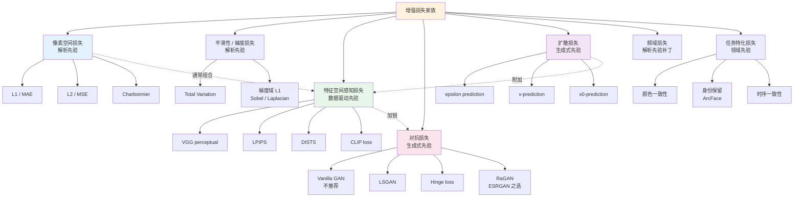
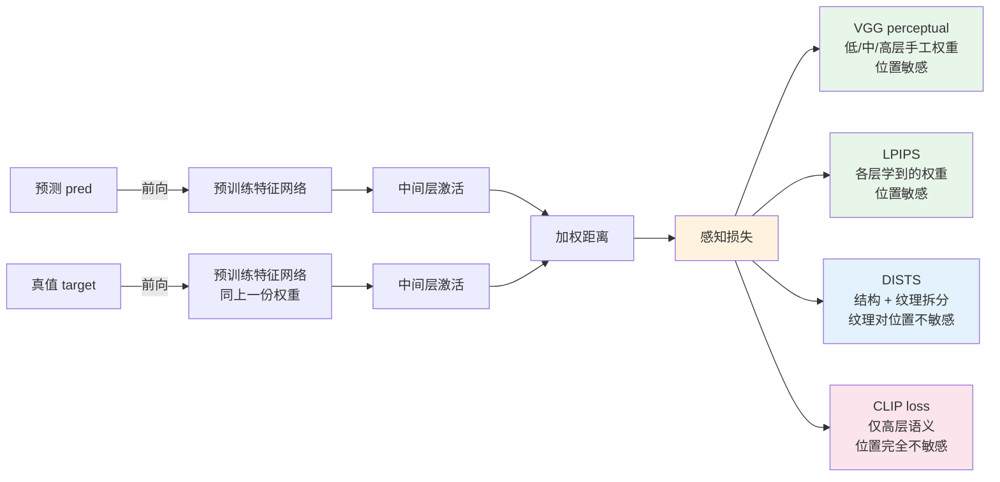

# 第 3 章 · 损失函数全景

> 增强模型的损失函数几乎从来不是单一的。理解为什么要混合多项损失，以及具体怎么配比，是这一章要回答的问题。

## 3.0 读这一章之前

第 2 章把“在哪个空间工作”拆成了三个维度：在哪个空间做预测、在哪个空间算损失、在哪个空间做评估。这一章聚焦其中第二个维度：当我们训练一个影像增强模型时，被最小化的那个标量到底由哪些项构成？每一项各自在惩罚什么？又为什么几乎不能只用单独一项？

读完这一章，你应当能清楚回答这些问题：

- 为什么 L2（MSE）在数学上最规整，在复原工程上却普遍输给 L1 与 Charbonnier
- Charbonnier 损失与 L1、L2 的梯度动力学有什么差别，为什么低层视觉论文偏爱它
- 感知损失、对抗损失与扩散损失三个家族各自的适用边界在哪里
- 面对一个新任务时，多项损失的权重应该从什么量级开始试、按什么顺序加
- 观察分项训练曲线时，哪些异常波动提示哪类权重失衡

本章预设你已读完第 2 章，了解像素空间、特征空间与潜空间的区别，并熟悉高斯分布与拉普拉斯分布下的最大似然估计：L1 与 L2 在工程表现上的差异，几乎都源于这两种分布的尾部形态与统计最优解。

**本章首次出现的缩写。** 前两章已介绍过的术语不再重复，本章新增的缩写包括：

- **MSE**（Mean Squared Error，均方误差）：L2 损失在统计学传统下的常用名称
- **MAE**（Mean Absolute Error，平均绝对误差）：L1 损失的常用名称
- **TV**（Total Variation，总变差）：以相邻像素差分范数作为惩罚项的正则损失，鼓励画面分段平滑
- **LSGAN**（Least Squares GAN，最小二乘 GAN）：用 MSE 替代交叉熵的对抗损失变体，缓解梯度饱和
- **Hinge loss**（合页损失）：只惩罚未达到分类间隔（margin）样本的对抗损失，现代 GAN 的主流选择
- **RaGAN**（Relativistic average GAN，相对论平均 GAN）：判别器预测“真图比假图平均更像真图的程度”，是 ESRGAN 系列的核心对抗损失
- **R1 / R2 正则**：在判别器上对真样本（R1）或假样本（R2）施加梯度范数平方惩罚，防止判别器梯度爆炸
- **TTUR**（Two-Time-Scale Update Rule，双时间尺度更新规则）：判别器与生成器使用不同学习率的训练策略
- **FFL**（Focal Frequency Loss，焦点频率损失）：在二维傅里叶频域计算的自适应加权损失，重点惩罚难恢复的高频分量
- **SNR**（Signal-to-Noise Ratio，信噪比）：扩散过程中信号能量与噪声能量的比值，常用于设计各时间步的损失权重
- **ArcFace**：人脸识别领域的标准特征提取网络，在人脸修复中常用来计算身份保留损失（Identity Loss）

## 3.1 为什么需要这一章

大语言模型预训练的损失函数基本只有一个：next-token 交叉熵。图像分类的主损失也基本只有一个：交叉熵。

影像增强则完全不同。翻开任何一篇主流复原或超分论文，训练目标那一节通常长这样：

$$
\mathcal{L} = \lambda_1 \mathcal{L}_{\text{pixel}} + \lambda_2 \mathcal{L}_{\text{perceptual}} + \lambda_3 \mathcal{L}_{\text{adversarial}} + \lambda_4 \mathcal{L}_{\text{...}}
$$

动辄三四个甚至五六个损失项加权求和。为什么要搞得这么复杂？原因在前两章其实已经埋下：

- 影像增强是不适定逆问题，必须引入先验，而每一项损失函数本质上都是在把某种先验编码进训练目标
- 不同损失函数关注不同的频段（像素 L1/L2 稳住低频，感知损失约束中高频结构，对抗损失逼出超高频纹理）
- 只用单一损失会让模型走极端：只用 L2 会导致画面模糊，只用对抗损失会造出满屏假纹理，只用 VGG 感知损失则容易出现整体色偏或棋盘格伪影

如果把第 1 章讲的三种先验来源映射到损失函数上，对应关系非常清晰：
- **解析先验**对应像素空间的 L1/L2、TV 与梯度损失（假设输出逐像素接近真值、平坦区光滑而边缘陡峭）；
- **数据驱动先验**对应 VGG、LPIPS、DISTS、CLIP 等特征空间损失（假设输出在预训练视觉网络的特征流形上接近真值）；
- **生成式先验**对应 GAN 对抗损失与扩散去噪损失（假设输出落在自然图像的真实分布上）。

这也引出了一条关键的工程原则：每往训练代码里新加一项损失，都要先问清楚它代表什么先验，以及它会不会和已有的损失项左右互搏。比如新手常犯的一个错误是把 TV 平滑损失的权重调得很大，同时又加上很强的 GAN 对抗损失；一个拼命抹平高频梯度，另一个拼命制造高频细节，两相拉扯之下，模型就会吐出“大块区域像涂了蜡一样平滑、边缘却带着诡异锐化噪点”的怪异图像。

> 增强模型的训练，不是单纯地“让输出逼近唯一真值”，而是在多个相互牵制的目标之间寻找一个 Pareto 平衡点。
>
> 调节各项损失的权重 $\lambda_i$，就是在明确告诉模型：当保真度、边缘锐度与纹理真实感发生冲突时，你优先保哪一头。

这也决定了增强模型的训练监控方式与单目标任务不同：单目标训练里损失下降通常就意味着模型变好；而在多损失混合训练里，总损失的值几乎没有参考意义，某一项损失的下降往往伴随着另一项损失的抬升。你必须把每一项损失单独画成曲线分开监控（第 11 章会专门展开）。

先用一张全景图把常用损失函数的家族关系梳理出来。图中实线表示分类从属，虚线表示工程上常配对组合：



## 3.2 像素空间损失

像素空间损失是最基础的保真约束，直接在预测图 $\hat{x}$ 与真值图 $x$ 的逐像素差值上计算。

### L2（MSE）：数学好用，工程不好用

$$
\mathcal{L}_2 = \frac{1}{N} \sum_i (\hat{x}_i - x_i)^2
$$

L2 损失在数学上非常讨喜：

- 对应独立同分布高斯噪声假设下的最大似然估计：假设 $x = \hat{x} + \mathcal{N}(0, \sigma^2 I)$，负对数似然去掉常数项与缩放因子后就是 $\sum_i (\hat{x}_i - x_i)^2$
- 处处光滑可导，严格凸，梯度为 $2(\hat{x}_i - x_i)$
- 与评估指标 PSNR 严格单调对应（最小化 MSE 等价于最大化 PSNR）

但直接拿 L2 训练图像复原模型，会遇到三个明显的工程问题：

- **对异常值极度敏感**：一个像素如果出现较大偏差 $e$，平方后变成 $e^2$，梯度与误差成正比，少量噪点或配准偏差就会绑架整个批次的梯度方向。
- **把输出拉向条件均值**：在不适定逆问题里，同一个退化输入 $y$ 对应一簇可能的高清图像 $\{x\}$。最小化期望平方误差 $\mathbb{E}[\|\hat{x} - x\|^2 \mid y]$ 的解析最优解是条件期望 $\hat{x}^* = \mathbb{E}[x \mid y]$。把许多张边缘位置略有差异的清晰图像取算术平均，得到的必然是一张边缘模糊的图像。
- **与人眼感知错位**：如第 2 章所验证的，L2 宁可让整张图全面轻微发糊，也不愿容忍局部纹理的锐利微偏。

因此在今天的影像增强工程里，单纯的像素 L2 几乎只出现在两个地方：

1. **扩散模型的单步去噪损失**：因为前向加噪过程本身加的就是精确的高斯白噪声，预测高斯噪声或速度场时 L2 在数学上恰好是精确的最大似然目标。而且扩散模型是靠数十步迭代逐步采样的，不需要一步到位输出所有可能结果的均值，因而不会落入单步回归的模糊陷阱。
2. **学术消融实验或专门刷 PSNR 的基准测试**。

### L1（MAE）：现代默认

$$
\mathcal{L}_1 = \frac{1}{N} \sum_i |\hat{x}_i - x_i|
$$

把平方换成绝对值后，性质发生了关键变化：

- 对应拉普拉斯（Laplace）重尾分布假设下的最大似然估计
- 对异常值鲁棒：无论单个像素误差有多大，它对梯度的贡献幅度恒为 $\pm 1$，不会被离群噪点拉偏
- 条件最优解是**条件中位数** $\text{median}(x \mid y)$ 而非条件均值，在双峰或多模态分布下更倾向于保持锐利阶跃而非居中抹平

在实测中，哪怕网络结构一行不改，仅仅把训练损失从 L2 换成 L1，不仅画面主观锐度会明显改善，连最终收敛出来的 PSNR 往往也会反超 L2 训练的结果（因为 L1 不容易陷入局部劣质平滑鞍点）。因此，几乎所有现代非扩散复原模型都以 L1 或其平滑变体 Charbonnier 作为像素损失底座。

### Charbonnier：L1 的平滑版

$$
\mathcal{L}_{\text{Charb}} = \frac{1}{N} \sum_i \sqrt{(\hat{x}_i - x_i)^2 + \epsilon^2}
$$

其中 $\epsilon$ 是一个很小的正常数（通常取 $10^{-3}$ 或 $10^{-6}$）。

为什么要给 L1 加上这个 $\epsilon^2$？因为标准 L1 在误差 $e = \hat{x}_i - x_i = 0$ 处不可导，只要误差哪怕只有 $10^{-7}$，梯度依然是满幅度的 $\pm 1$，这会导致训练后期参数在真值附近来回微幅震荡。而 Charbonnier 损失对误差 $e$ 的导数为：

$$
\frac{\partial \mathcal{L}_{\text{Charb}}}{\partial e} = \frac{e}{\sqrt{e^2 + \epsilon^2}}
$$

把 L2、L1 与 Charbonnier 三者在不同误差区间内的梯度行为摆在一起对比，差异一目了然：

- **极小误差区（$|e| \ll \epsilon$）**：L2 梯度为 $2e \approx 0$；L1 梯度仍为 $\pm 1$；Charbonnier 梯度近似为 $e / \epsilon$，随误差趋零而平滑衰减到 0。注意由于 $\epsilon$ 常取 $10^{-3}$，这条平滑过渡带其实非常窄，一旦误差处在 $\epsilon \ll |e| \ll 1$ 区间，Charbonnier 的梯度就已经十分接近 $\pm 1$。
- **中等误差区（$|e| \approx 1$）**：三者梯度处于同一量级。
- **大误差/异常值区（$|e| \gg 1$）**：L2 梯度 $2e$ 随异常值线性暴涨；L1 与 Charbonnier 的梯度则都饱和在 $\pm 1$，对异常值同样鲁棒。

可以看到，Charbonnier 在绝大多数训练阶段的行为与 L1 几乎一致，但它消除了零点处的梯度跳变，在训练收尾、误差进入 $\epsilon$ 邻域时能平稳收敛。SwinIR、Restormer、NAFNet 等主流模型在论文正文中常简写为 L1 损失，但翻看官方开源代码就会发现，很多实际调用的都是 Charbonnier 损失。

```python
import torch

def charbonnier_loss(pred: torch.Tensor, target: torch.Tensor,
                     eps: float = 1e-3) -> torch.Tensor:
    """Charbonnier 损失 (L1 的平滑可导版本)。
    比 L1 在零点附近更平稳, 比 L2 对异常值更鲁棒, 是低层视觉的常用默认项。
    """
    diff = pred - target
    return torch.sqrt(diff * diff + eps * eps).mean()
```

## 3.3 平滑性 / 梯度损失

像素损失只孤立地考核每个像素位置自身的数值差，而**梯度损失**考核的是相邻像素之间的差分关系。

### Total Variation（总变差损失）

$$
\mathcal{L}_{\text{TV}} = \sum_{i,j} \left( |\hat{x}_{i+1,j} - \hat{x}_{i,j}| + |\hat{x}_{i,j+1} - \hat{x}_{i,j}| \right)
$$

TV 损失直接惩罚预测图像自身相邻像素的绝对差，鼓励图像保持**分段常数**（piecewise constant）：平坦区域内部没有高频杂波，只保留必要的剧烈边缘阶跃。

```python
def total_variation_loss(x: torch.Tensor) -> torch.Tensor:
    """TV 损失 (各向异性版本)。
    x: (B, C, H, W)
    """
    dh = (x[:, :, 1:, :] - x[:, :, :-1, :]).abs().mean()
    dw = (x[:, :, :, 1:] - x[:, :, :, :-1]).abs().mean()
    return dh + dw
```

TV 损失只看预测图 $\hat{x}$ 自己，不需要真值 $x$。工程上它主要用在两个地方：
- 在盲去噪或弱监督去噪中压制残留的孤立噪点；
- 在 GAN 或扩散复原中，以极小的权重（通常 $\lambda = 10^{-5} \sim 10^{-3}$）抑制生成模型在天空、墙壁等平坦区域凭空捏造出的细碎伪影。权重一旦给大，画面就会染上严重的水彩涂抹感。

实现上 TV 有两种微调形式：上面代码写的是**各向异性**（anisotropic）版本，分别对水平与垂直差分取绝对值相加，偏好水平或垂直对齐的边缘（适合建筑、文档）；另一种是**各向同性**（isotropic）版本，计算 $\sqrt{(\Delta_h \hat{x})^2 + (\Delta_w \hat{x})^2 + \epsilon^2}$，在各个方向上旋转对称，更适合天空、皮肤等自然连续表面。

### 梯度域损失（Gradient Loss）

与只压制梯度的 TV 不同，梯度域损失要求预测图 $\hat{x}$ 的边缘梯度与真值图 $x$ 的边缘梯度逐处对齐：

$$
\mathcal{L}_{\text{grad}} = \|\nabla \hat{x} - \nabla x\|_1
$$

```python
import torch.nn.functional as F

# Sobel kernels
SOBEL_X = torch.tensor([[-1., 0., 1.],
                        [-2., 0., 2.],
                        [-1., 0., 1.]]).view(1, 1, 3, 3)
SOBEL_Y = SOBEL_X.transpose(-1, -2)

def gradient_loss(pred: torch.Tensor, target: torch.Tensor) -> torch.Tensor:
    """梯度域 L1 损失。强迫预测的边缘和真值边缘对齐。
    pred, target: (B, C, H, W), 假设值域 [0, 1]
    """
    sobel_x = SOBEL_X.to(pred).expand(pred.shape[1], 1, 3, 3)
    sobel_y = SOBEL_Y.to(pred).expand(pred.shape[1], 1, 3, 3)

    pred_gx = F.conv2d(pred, sobel_x, padding=1, groups=pred.shape[1])
    pred_gy = F.conv2d(pred, sobel_y, padding=1, groups=pred.shape[1])
    targ_gx = F.conv2d(target, sobel_x, padding=1, groups=target.shape[1])
    targ_gy = F.conv2d(target, sobel_y, padding=1, groups=target.shape[1])

    return (pred_gx - targ_gx).abs().mean() + (pred_gy - targ_gy).abs().mean()
```

梯度域损失在**去模糊**和**文档清晰化**等极度看重边缘锐度的任务里非常实用，而且计算开销远小于跑一遍 VGG 网络。算子选择上，一阶 Sobel 算子方向感强、抗噪性好，适合通用去模糊；二阶 Laplacian 算子各向同性、对细线敏感，但容易放大残余噪声，更常用于干净文档或线条画超分。在 4× 或 8× 超分中，还可以构建高斯金字塔，在多个下采样尺度上同时计算梯度域 L1（即多尺度梯度损失），兼顾粗轮廓与细边缘。

## 3.4 感知损失

第 2 章已经给出了 VGG 感知损失（VGG perceptual loss）的原理与代码实现。这一节补充感知损失家族里的另外三位成员，并比较它们的适用边界。

### LPIPS

LPIPS（Learned Perceptual Image Patch Similarity，2018）把手工指定层权重的感知损失改造成了数据驱动校准的版本：

1. 将两张图送入预训练骨干网络（AlexNet、VGG 或 SqueezeNet）提取多层特征并沿通道维做单位归一化
2. 对每一层、每一个通道的特征差平方乘以一组学习出来的非负线性权重 $w_l$
3. 这组线性权重是在大规模人类主观偏好数据集（BAPPS）上拟合出来的

这里要注意 LPIPS 在**评估**与**训练**两个场景下的微妙差别：作为评估指标时，LPIPS（尤其是 `net='alex'`）与人眼判断的相关性显著优于未校准的朴素 VGG 距离；但直接把 LPIPS 当成主训练损失反传梯度时，生成器很容易钻那组固定线性权重 $w_l$ 的空子，优化出专门欺骗 LPIPS 读数的高频棋盘格或网纹伪影。因此工程上的常见分工是：**训练时用结构更透明的 VGG 感知损失（或选用 `lpips(net='vgg')` 并配以较小权重），评估时用 `lpips(net='alex')` 打分**。

### DISTS

DISTS（Deep Image Structure and Texture Similarity，2020）将 VGG 各层特征图的比较拆成了两部分：用特征图的空间相关性度量**结构相似度**，用特征图的全局通道均值与方差度量**纹理相似度**。

它的最大优势是对局部纹理的具体空间相位不敏感：生成出来的草地、毛发或砖墙只要整体纹理统计量与真值一致，哪怕每一根草叶的位置没有和真值逐像素对齐，DISTS 也不会重罚。在生成式超分与人脸、材质复原中，用 DISTS 作为感知损失往往比逐位置严格对齐的 VGG L1 更自然。

### CLIP loss

把预测图和真值图（或文本提示词）送入预训练 CLIP 图像编码器，在高层语义嵌入空间计算余弦距离。

CLIP 编码器经过跨模态图文对比训练，它几乎不关心像素级的边缘锐度，只关心高层语义概念对不对。单独用 CLIP loss 绝对训不出清晰的复原模型，但在重度退化的生成式复原中，以 `0.01` 左右的小权重加上一项 CLIP 损失，可以有效防止模型发生“语义漂移”（例如把模糊的猫耳修成狗耳，或把亚洲人脸修成欧美面孔）。

下面这张图对比了四种感知损失在“语义层级”与“位置敏感度”上的分布：



## 3.5 对抗损失

GAN（生成对抗网络）损失是判别式复原模型跨越“均值模糊陷阱”、生成锐利高频纹理的关键武器，同时也是训练中最容易失稳发散的环节。

### Vanilla GAN：不要直接用

2014 年原始 GAN 的极小极大博弈目标为：

$$
\min_G \max_D \mathbb{E}_{x \sim p_{\text{data}}} [\log D(x)] + \mathbb{E}_{z \sim p_z} [\log(1 - D(G(z)))]
$$

这里 $G$ 是生成器（在增强任务里就是复原网络 $f_\theta$），$D$ 是判别器。需要提醒一句：本章的 $D$ 一律指判别器（Discriminator），与第 1 章记号约定里的退化算子 $D$ 不是同一个对象，只是沿用了各自领域的标准记号。

原始 GAN 的对数交叉熵形式在工程上非常脆弱：一旦判别器 $D$ 训练得比生成器 $G$ 快、能轻易分开真图与复原图，就会出现梯度饱和或剧烈震荡，导致生成器陷入模式崩溃（mode collapse）或画面满屏彩色噪点。现代图像复原工程几乎不再直接使用原始 GAN 损失，而是采用下面三种改进变体：LSGAN（2017）、Hinge loss（2017-2018）和 RaGAN（2018）。

### LSGAN：简单稳定

LSGAN 把判别器最后一层 sigmoid 与对数交叉熵直接替换成最小二乘回归（MSE）：

$$
\mathcal{L}_D = \frac{1}{2}\mathbb{E}[(D(x) - 1)^2] + \frac{1}{2}\mathbb{E}[(D(G(y)))^2]
$$
$$
\mathcal{L}_G = \frac{1}{2}\mathbb{E}[(D(G(y)) - 1)^2]
$$

只要假样本远离真值标签 $1$，LSGAN 就会提供与距离成正比的平滑梯度，训练不易饱和，超参数也比较好调。

### Hinge loss：现代 GAN 标准

$$
\mathcal{L}_D = \mathbb{E}[\max(0, 1 - D(x))] + \mathbb{E}[\max(0, 1 + D(G(y)))]
$$
$$
\mathcal{L}_G = -\mathbb{E}[D(G(y))]
$$

Hinge 损失引入了分类间隔（margin）：当判别器对某个真样本打分已经大于 $1$、或对某个假样本打分已经小于 $-1$ 时，该样本不再产生判别器梯度，防止判别器在容易区分的样本上过度自信。这是 BigGAN、StyleGAN 乃至 VQGAN 判别器广泛采用的标准形式。

```python
def hinge_d_loss(d_real: torch.Tensor, d_fake: torch.Tensor) -> torch.Tensor:
    """Hinge 损失 (判别器一侧)。
    d_real, d_fake: 判别器对真/假图的输出 logits, shape (B,) 或 (B, 1, h', w')
    """
    loss_real = F.relu(1.0 - d_real).mean()
    loss_fake = F.relu(1.0 + d_fake).mean()
    return loss_real + loss_fake


def hinge_g_loss(d_fake: torch.Tensor) -> torch.Tensor:
    """Hinge 损失 (生成器一侧)。"""
    return -d_fake.mean()
```

### Relativistic GAN（RaGAN）：ESRGAN 之选

ESRGAN 采用的是相对论平均生成对抗网络（Relativistic average GAN，RaGAN）。它的核心观察是：判别器不应该孤立地判断“这张图是不是真图”，而应该判断“这张真图是不是比当前批次的假图平均更像真图”：

$$
D_{\text{Ra}}(x_r, x_f) = \sigma(D(x_r) - \mathbb{E}[D(x_f)])
$$

$$
D_{\text{Ra}}(x_f, x_r) = \sigma(D(x_f) - \mathbb{E}[D(x_r)])
$$

在生成器更新时，真图和假图的判别得分同时参与梯度计算，迫使生成器不仅要把假图往真图方向推，还要参考当前批次真图的响应水平。

```python
def relativistic_d_loss(d_real: torch.Tensor, d_fake: torch.Tensor) -> torch.Tensor:
    """RaGAN 判别器损失 (ESRGAN 风格)。"""
    real_logits = d_real - d_fake.mean()
    fake_logits = d_fake - d_real.mean()
    return (F.binary_cross_entropy_with_logits(real_logits, torch.ones_like(real_logits))
          + F.binary_cross_entropy_with_logits(fake_logits, torch.zeros_like(fake_logits)))


def relativistic_g_loss(d_real: torch.Tensor, d_fake: torch.Tensor) -> torch.Tensor:
    """RaGAN 生成器损失。
    注意: 调用前 d_real 和 d_fake 应当是 D 在 G 输出和真值上的当前 logits,
    且反传时 D 的参数必须冻结 (在 G step 里将 D 的 requires_grad 设为 False),
    避免 G 的损失意外累积到 D 的梯度上。
    """
    real_logits = d_real - d_fake.mean()
    fake_logits = d_fake - d_real.mean()
    return (F.binary_cross_entropy_with_logits(fake_logits, torch.ones_like(fake_logits))
          + F.binary_cross_entropy_with_logits(real_logits, torch.zeros_like(real_logits)))
```

在超分辨率任务上，RaGAN 生成的边缘和微纹理通常比普通 GAN 更细腻，是 ESRGAN 与 Real-ESRGAN 系列的标准配置（注：Real-ESRGAN 为了 accommodating U-Net 判别器的逐像素输出，在后期版本中也常搭配标准 BCE + 谱归一化使用）。

### PatchGAN 与 U-Net 判别器

在图像增强里，判别器很少把整张图压成一个全局标量，而是输出一张二维判别特征图 $(B, 1, h', w')$（或像 Real-ESRGAN 的 U-Net 判别器那样输出与原图同分辨率的 $(B, 1, H, W)$ 判别图），每个空间位置独立判断对应局部感受野内的纹理真假。

这样做有三个明显好处：
- **局部精细监督**：生成器没法靠“主体清楚、背景糊弄”蒙混过关，每个局部块都会收到独立的真假梯度。
- **支持任意分辨率输入**：全卷积结构没有固定尺寸的全连接层。
- **训练更稳定**：单张图提供几百上千个局部判别信号，梯度方差更小。

```python
class PatchDiscriminator(nn.Module):
    """70x70 感受野的 PatchGAN 判别器, Pix2Pix 风格。"""
    def __init__(self, in_ch: int = 3, base_ch: int = 64):
        super().__init__()
        layers = [
            nn.Conv2d(in_ch, base_ch, 4, stride=2, padding=1),
            nn.LeakyReLU(0.2, inplace=True),
        ]
        chs = [base_ch, base_ch * 2, base_ch * 4, base_ch * 8]
        for i in range(len(chs) - 1):
            stride = 2 if i < 2 else 1
            layers += [
                nn.Conv2d(chs[i], chs[i+1], 4, stride=stride, padding=1),
                nn.GroupNorm(8, chs[i+1]),
                nn.LeakyReLU(0.2, inplace=True),
            ]
        layers.append(nn.Conv2d(chs[-1], 1, 4, stride=1, padding=1))
        self.model = nn.Sequential(*layers)

    def forward(self, x: torch.Tensor) -> torch.Tensor:
        return self.model(x)  # 输出 (B, 1, h', w') logits, 不含 sigmoid
```

### 判别器正则化：谱归一化与 R1 正则

光靠换对抗损失公式还不够，要让 GAN 训练长期不崩，还必须限制判别器函数的梯度陡峭程度（即 Lipschitz 常数）：

- **谱归一化**（Spectral Normalization）：对判别器每一层卷积权重矩阵除以它的最大奇异值 $\sigma(W)$，把每层的 Lipschitz 常数硬性约束在 1 以内。Real-ESRGAN 的 U-Net 判别器就重度依赖谱归一化来压制训练后期的伪影。
- **R1 梯度惩罚**：直接惩罚判别器在真实样本 $x$ 处的输入梯度范数平方：

$$
\mathcal{L}_{R1} = \frac{\gamma}{2} \mathbb{E}_{x \sim p_{\text{data}}} \left[ \|\nabla_x D(x)\|^2 \right]
$$

其直觉是：当判别器已经收敛到理想均衡附近时，它在真实数据流形上的梯度应当接近 0，不该因为微小像素扰动就剧烈跳变。$\gamma$ 通常取 $1 \sim 10$。这里要区分两条不同的工程流派：**StyleGAN2** 采用的核心稳定组合是 **R1 正则 + path-length 正则**（并配合每隔 16 步才算一次正则项的 lazy regularization 来节省算力），并不使用谱归一化；而 **SNGAN、BigGAN** 与 **Real-ESRGAN** 走的则是谱归一化路线。

第 11 章会专门展开 GAN 训练崩溃的诊断与救治细节。

## 3.6 扩散损失

扩散模型的训练目标基于去噪得分匹配（denoising score matching）或流匹配（flow matching），与上面直接比较 $\hat{x}$ 和 $x$ 的判别式损失属于不同的体系。

### Simple loss（$\epsilon$-prediction）

DDPM 最经典的训练目标是让网络直接预测前向加进去的标准高斯噪声 $\epsilon$：

$$
\mathcal{L}_{\text{simple}} = \mathbb{E}_{t, x_0, \epsilon} \left[ \|\epsilon - \epsilon_\theta(x_t, t)\|^2 \right]
$$

```python
def diffusion_simple_loss(model, x0, t, noise_scheduler):
    """DDPM 标准的 epsilon prediction 损失。
    model: UNet, 输入 (x_t, t) 输出预测噪声
    x0: 原始图像 (B, C, H, W) 或潜变量 (B, c, h, w)
    t: 时间步 (B,)
    noise_scheduler: 提供 alpha_cumprod
    """
    noise = torch.randn_like(x0)
    sqrt_alpha = noise_scheduler.sqrt_alphas_cumprod[t].view(-1, 1, 1, 1)
    sqrt_one_minus_alpha = noise_scheduler.sqrt_one_minus_alphas_cumprod[t].view(-1, 1, 1, 1)
    x_t = sqrt_alpha * x0 + sqrt_one_minus_alpha * noise
    pred_noise = model(x_t, t)
    return F.mse_loss(pred_noise, noise)
```

### $v$-prediction：全时间步数值更均衡

单纯预测噪声 $\epsilon$ 在高信噪比端（$t \to 0$，几乎没加噪）和极低信噪比端（$t \to T$，几乎纯噪声）容易出现梯度信号失衡。Salimans 与 Ho（2022）提出改为预测速度向量 $v_t$：

$$
v_t = \sqrt{\bar{\alpha}_t} \cdot \epsilon - \sqrt{1 - \bar{\alpha}_t} \cdot x_0
$$

其中 $\sqrt{\bar{\alpha}_t}$ 与 $\sqrt{1 - \bar{\alpha}_t}$ 分别是信号与噪声的缩放系数（第 8 章会完整推导）。$v_t$ 同时混合了信号与噪声，在整个时间轴 $t \in [0, T]$ 上梯度方差更均匀，能有效缓解高分辨率扩散模型常见的整体色调偏移问题。代表模型中，Stable Diffusion 2.x 的 768-v 版本与 Imagen Video 采用 $v$-prediction，而 SD 1.5 与 SDXL（含 base 和 refiner）则依然采用 $\epsilon$-prediction。至于 2024 年之后的 SD3、FLUX 等基于 Rectified Flow 的模型，则进一步统一为预测线性插值路径上的速度场（velocity prediction）。

### $x_0$-prediction

第三种等价参数化是让网络直接输出对干净信号 $x_0$（或干净潜表示 $z_0$）的估计 $\hat{x}_0(x_t, t)$。

在影像增强任务里，$x_0$-prediction 有一个独特的工程便利：因为模型直接输出了估计的干净图（或干净潜表示），你可以非常方便地在训练时直接对 $\hat{x}_0$ 附加上 LPIPS 感知损失、像素 L1 损失或色彩一致性损失，而不必先从预测的微弱噪声里通过大系数除法反推 $\hat{x}_0$（在 $t$ 接近 $T$ 时反推会放大数值误差）。不过，当 $t$ 很大、输入几乎是纯噪声时，直接预测 $x_0$ 的方差很大，因此必须配合下面的时间步加权策略一起使用。

工程选型经验如下：
- **基于现有开源底座微调**（如基于 SD 1.5、SDXL、SD3 训练 ControlNet 或 LoRA）：严格沿用原底座 checkpoint 的 `prediction_type`（可通过 `scheduler.config.prediction_type` 查看），切忌中途强行切换目标类型。
- **从头训练专门的扩散复原小模型**：优先选 $v$-prediction，或者选 $x_0$-prediction 配合 Min-SNR 权重。

### Min-SNR 时间步加权

在扩散训练中，不同时间步 $t$ 的去噪任务难度天差地别：$t$ 很小时输入几乎等于原图，网络不用费力就能拿到很低的损失；$t$ 接近 $T$ 时输入几乎是纯噪声，强行要求还原细节又会产生巨大的无效梯度。

Hang 等人（2023）提出的 **Min-SNR-$\gamma$** 加权策略，按每个时间步的信噪比 $\text{SNR}(t) = \bar{\alpha}_t / (1 - \bar{\alpha}_t)$ 对损失做截断加权（在 $\epsilon$-prediction 下）：

$$
w(t) = \frac{\min(\text{SNR}(t), \gamma)}{\text{SNR}(t)}
$$

其中超参数 $\gamma$ 通常取 $5$。这个公式把过高信噪比区段的权重压低，让模型的有效梯度集中在最关键的中间去噪阶段。在退化图像作为强条件输入的扩散复原训练里，低噪声步本来就极易偷懒，加上 Min-SNR 加权能让收敛速度和纹理锐度都显著提升。

```python
import torch

def min_snr_weight(t: torch.Tensor, alphas_cumprod: torch.Tensor,
                   gamma: float = 5.0) -> torch.Tensor:
    """Min-SNR 加权 (Hang et al. 2023, 对应 epsilon-prediction)。
    t: (B,) 时间步索引
    alphas_cumprod: (T,) 完整的 alpha 累积乘积
    返回: (B,) 每个时间步的损失权重
    """
    a = alphas_cumprod[t]
    snr = a / (1.0 - a).clamp(min=1e-8)
    return snr.clamp(max=gamma) / snr
```

## 3.7 频域损失

第 2.6 节讲过，自然图像的功率谱按 $1/f^2$ 衰减，加上神经网络自身的低频偏置，时域里的逐点 L1/L2 损失在高频段提供的有效梯度非常微弱。**频域损失**的思路很直接：先把预测图与真值图通过二维快速傅里叶变换（2D FFT）映射到频域，让每一个频率分量独立对齐。

### Focal Frequency Loss（FFL）

Jiang 等人（2021）提出的焦点频率损失（FFL）不仅在复数频域算距离，还借鉴了 Focal Loss 的思想，根据当前每个频率点上的误差大小动态赋权，强迫模型攻克那些最难恢复的高频成分：

```python
import torch

def focal_frequency_loss(pred: torch.Tensor, target: torch.Tensor,
                         alpha: float = 1.0) -> torch.Tensor:
    """Focal Frequency Loss (FFL, Jiang et al. 2021)。
    把预测和真值都做 2D FFT, 在频域算自适应加权 L2,
    误差越大的频率分量权重越高。
    pred, target: (B, C, H, W)
    """
    pred_fft   = torch.fft.fft2(pred,   norm='ortho')
    target_fft = torch.fft.fft2(target, norm='ortho')

    diff = pred_fft - target_fft
    distance = (diff.real ** 2 + diff.imag ** 2)  # |.|^2

    # focal 权重 (难训的频率分量权重大, 截断梯度只作权重)
    weight = distance.detach() ** alpha
    weight = weight / (weight.max() + 1e-8)

    return (weight * distance).mean()
```

在实际工程中，当你在 4× 超分或去模糊任务里发现像素损失已经收敛、但砖墙或织物依然发肉时，给主损失配上一项权重为 `0.05 ~ 0.1` 的 FFL（或直接在频域幅度谱与相位谱上算 L1），往往能以极低的计算开销换来明显的锐度提升。但切忌把频域损失权重设得过大，否则空域画面上容易浮现周期性的网格振铃伪影。

## 3.8 任务特化损失

除了上述通用损失外，针对特定垂直场景加入领域先验损失，往往能四两拨千斤。

### 颜色一致性损失（Color Consistency Loss）

GAN 与潜空间扩散模型在长时间训练或强感知损失驱动下，很容易发生整体色调漂移（比如画面整体偏黄、偏品红或对比度异常拉高），因为 VGG 特征经过了均值方差归一化，对低频色偏并不敏感。

堵住这个漏洞的最简方案，是对预测图和真值图先做一次大核均值池化（抹掉一切高频纹理，只留低频色块），再算 L1 距离；或者转换到 YCbCr / Lab 空间专门约束色度通道：

```python
def color_consistency_loss(pred: torch.Tensor, target: torch.Tensor) -> torch.Tensor:
    """对预测和真值都做大幅模糊后比较, 只关心低频色调而不限制高频细节。
    简单有效, 常用于 GAN 与扩散复原防止整体色偏。
    """
    pred_blur   = F.avg_pool2d(pred,   kernel_size=11, stride=1, padding=5)
    target_blur = F.avg_pool2d(target, kernel_size=11, stride=1, padding=5)
    return F.l1_loss(pred_blur, target_blur)
```

### 身份保留损失（Identity Loss，人脸专用）

在盲人脸修复（如 GFPGAN、CodeFormer）中，通用感知损失只管“修出来的五官像不像一张清晰的人脸”，不管“修出来的人还像不像原来的那个人”。为此需要引入预训练的人脸识别网络 **ArcFace**，提取预测人脸与真值人脸的 512 维身份特征向量，最小化两者的余弦距离：

```python
class IdentityLoss(nn.Module):
    """人脸修复专用：用预训练 ArcFace 提取身份嵌入并计算余弦距离。"""
    def __init__(self, arcface_model: nn.Module):
        super().__init__()
        self.arcface = arcface_model.eval()
        for p in self.arcface.parameters():
            p.requires_grad_(False)

    def forward(self, pred: torch.Tensor, target: torch.Tensor) -> torch.Tensor:
        emb_pred   = self.arcface(pred)    # (B, 512)
        emb_target = self.arcface(target)
        return 1.0 - F.cosine_similarity(emb_pred, emb_target).mean()
```

第 10 章会结合人脸关键点局部判别器（眼睛、嘴部 ROI 损失）进一步展开。

### 时序一致性损失（视频专用）

在视频超分与去噪中，如果逐帧独立优化，即使每一帧单看都很清晰，连起来播放也会因为高频纹理逐帧随机跳变而产生刺眼的闪烁（flicker）。标准解法是用预训练光流网络（如 RAFT）算出相邻帧之间的光流场，把第 $t+1$ 帧的预测结果沿着光流反向对齐（warp）到第 $t$ 帧坐标，并在非遮挡区域内惩罚它与 $\hat{x}_t$ 的差异。第 13 章会详细推导。

### 其他常见领域损失

- **文档二值化边缘损失**：在文档去阴影和超分中，加强文字前景与纸张背景的对比度梯度，直接提升下游 OCR 识别率。
- **天空/平坦区掩码 TV**：结合轻量分割掩码，对天空、纯色背景单独加大平滑惩罚，防止生成式超分在蓝天里造出假纹理。
- **Log / $\mu$-law 域トーン映射损失**：在 HDR 重建与极暗光增强中，先对线性辐射度做对数或 $\mu$-law 压缩再算 L1 + 感知损失，避免高亮区像素统治全部梯度。

这类领域损失通常以 `0.01 ~ 0.1` 的小权重挂在主损失旁边，不改变训练的主干动力学，专门负责守住业务底线。

## 3.9 混合策略：这一章的核心

认识了所有零件之后，工程上最核心的问题是：把它们组合在一起时，权重该怎么配？训练流程该怎么排？

### 经典 ESRGAN 配方

$$
\mathcal{L}_G = \lambda_1 \mathcal{L}_1 + \lambda_2 \mathcal{L}_{\text{percep}} + \lambda_3 \mathcal{L}_{\text{adv}}
$$

原始 ESRGAN 的经典权重配置是：
- $\lambda_1 = 10^{-2}$（像素 L1）
- $\lambda_2 = 1.0$（VGG 激活前特征感知损失）
- $\lambda_3 = 5 \times 10^{-3}$（RaGAN 对抗损失）

注意这里像素 L1 的权重只有 `0.01`，真正主导训练方向的是权重为 `1.0` 的 VGG 感知损失。原始 ESRGAN 之所以把像素项压得这么低，是因为它在干净 bicubic 退化上追求极致的纹理锐度，像素 L1 只用来防止画面色彩和几何大结构跑偏。（把像素 L1 权重提高到 `1.0` 是下面 Real-ESRGAN 的配方，切勿把两者混为一谈。）同时也要注意对抗损失权重只有 `0.005`，因为未归一化的对抗梯度幅值很大且带噪声，权重稍大就会把画面撕裂出伪影。

### Real-ESRGAN 配方

当训练数据从简单 bicubic 升级为复杂的二阶合成退化（第 5 章）后，Real-ESRGAN 将生成器损失调整为：

$$
\mathcal{L}_G = 1.0 \cdot \mathcal{L}_1 + 1.0 \cdot \mathcal{L}_{\text{percep}} + 0.1 \cdot \mathcal{L}_{\text{adv}}
$$

与原始 ESRGAN 相比，这里有两个关键变化：一是像素 L1 权重从 `0.01` 提到了 `1.0`，因为在重度复合退化下必须加强低频结构约束，否则生成器容易把严重退化区域脑补成错误结构；二是配合带谱归一化的 U-Net 判别器，对抗损失权重设在了 `0.1`，在去退化与补纹理之间取得平衡。

### 现代潜空间扩散复原配方

以 SUPIR、SeeSR、DiffBIR 等潜空间扩散模型为例，训练阶段的主损失是潜空间的去噪扩散损失（$\epsilon$-loss 或 $v$-loss），在此基础上部分工作或蒸馏方案（如 OSEDiff）会附加解码后的混合约束：

- **潜空间或像素空间 LPIPS 感知损失**（权重约 `0.1 ~ 1.0`）
- **解码后的像素空间 L1 损失**（权重约 `0.1 ~ 1.0`，抑制色彩与低频漂移）
- **对抗蒸馏或分布匹配损失**（在少步/单步蒸馏扩散 SR 中提供高频锐度）

### 为什么 GAN 训练必须分两阶段（Pretrain → Finetune）

训练感知导向模型（如 ESRGAN、Real-ESRGAN）时，最常踩的坑就是从第 0 步起就把像素损失、VGG 感知损失和 GAN 对抗损失一起打开。这样做十有八九会让训练在早期陷入剧烈震荡或生成满屏网格伪影。

标准的工程做法是严格的**两阶段训练法**：

1. **第一阶段（PSNR 导向预训练）**：只开像素 L1（或 Charbonnier）损失，训练一个纯保真模型（如原始 ESRGAN 先训出 PSNR 导向的 RRDBNet，Real-ESRGAN 先训出 Real-ESRNet），直到验证集 PSNR 完全收敛。此时模型已经学会了稳定的去退化与几何结构对齐，只是画面偏平滑。
2. **第二阶段（GAN 感知微调）**：加载第一阶段收敛的权重作为生成器的初始化，在此基础上加入 VGG 感知损失与 GAN 对抗损失，用小一个数量级的学习率继续微调。

为什么要先预训练？因为 GAN 博弈需要一个已经落在真实图像流形附近的合理起点。如果生成器从随机初始化出发、一上来吐出的全是无意义的噪声色块，判别器只需几个迭代步就能以 100% 的准确率区分真假，此后传回给生成器的对抗梯度要么饱和、要么指向杂乱的方向。先用像素损失把生成器训成一个合格的去模糊/超分网络，再引入判别器，判别器就必须去挑剔“高频纹理够不够逼真”这种真正有价值的细节差距。

落地执行两阶段训练时的具体操作要点：
- 第一阶段通常训练 200K ~ 500K 步，保存好收敛 checkpoint（它本身还可以拿来和阶段二的 GAN 权重做参数插值，用来平滑调节线上效果的锐度与伪影程度）。
- 进入第二阶段时，将生成器学习率下调（例如从 `2e-4` 降到 `1e-4` 或 `5e-5`）。
- 前 5K ~ 10K 步可以先只更判别器或对对抗损失权重做线性 warmup，避免判别器在冷启动阶段给生成器猛烈的一脚错误梯度。

### 分项损失曲线诊断表

训练时务必把每一项损失分别打点到 TensorBoard 或 WandB 上，对照下表排查异常：

| 训练曲线或验证图症状 | 常见根因 | 调整方向 |
|------|---------|---------|
| 像素 L1 持续下降，但验证集 LPIPS 居高不下、画面发肉 | 像素损失占绝对主导，模型停留在条件均值解 | 检查感知/对抗损失是否生效，适当上调其权重 |
| 生成器与判别器损失剧烈上下锯齿震荡 | 判别器更新过猛或未加正则 | 给判别器加谱归一化或 R1 正则，调低判别器学习率 |
| 刚开始微调几千步，画面突然炸出彩色噪点块 | 未加载预训练权重，或对抗损失权重过大 | 确认已加载阶段一预训练权重，将 $\lambda_{\text{adv}}$ 调小一个数量级 |
| VGG 感知损失一直降，但画面浮现细密棋盘格伪影 | 模型过拟合了固定 VGG 卷积核的对抗漏洞 | 换用激活前特征（pre-activation），或调高像素 L1 与 TV 权重 |
| 细节纹理清晰，但整张图色温偏黄或对比度跑偏 | 感知与对抗损失主导后丢失了直流低频锚点 | 提高像素 L1 权重，或加上大核均值池化的颜色一致性损失 |

## 3.10 损失选择决策表

下面按具体任务给出一套经过验证的初始损失配方（括号内为典型数量级，实际工程中需按各损失项未加权前的数值尺度微调）：

| 任务 | 主损失 | 辅助损失 | 典型代表 |
|------|--------|---------|------|
| 经典保真 SR（刷 PSNR） | Charbonnier / L1 | 无（或 + `0.05` FFL） | EDSR / SwinIR / HAT |
| 真实世界盲 SR（视觉导向） | `1.0` L1 + `1.0` VGG | + `0.1` GAN | Real-ESRGAN / BSRGAN |
| 图像去噪 | Charbonnier / L1 | + `1e-4` TV（可选） | NAFNet / Restormer |
| 图像去模糊 | Charbonnier + `0.1` 梯度域 L1 | + `0.05` FFL 或 VGG | MIMO-UNet / Restormer |
| 盲人脸修复 | L1 + VGG + GAN | + `0.1~1.0` ArcFace ID + 局部五官损失 | GFPGAN / CodeFormer |
| 潜空间扩散复原 | $\epsilon$ / $v$ / flow MSE（配 Min-SNR） | 解码端可选加 LPIPS + L1 | SUPIR / StableSR / DiffBIR |
| 单步蒸馏扩散 SR | 像素 L1 + LPIPS | + VSD（分布匹配）/ GAN 对抗损失 | OSEDiff / AddSR |
| 视频超分与去噪 | Charbonnier + VGG | + 光流对齐时序一致性损失 | BasicVSR++ |
| 视频帧插值 | Charbonnier / LapPyr L1 | + VGG 感知损失 | RIFE |

可以把各损失项的职责记成几条简单的对应关系：
- **要结构稳、不偏色**：靠像素 L1 / Charbonnier 与颜色一致性损失；
- **要边缘齐**：靠梯度域损失（Sobel / Laplacian）；
- **要摆脱模糊、纹理自然**：靠 VGG / LPIPS / DISTS 感知损失；
- **要逼出锐利的微细颗粒感**：靠 GAN 对抗损失或扩散生成先验；
- **要守住特定语义或人脸身份**：靠 ArcFace 身份损失或 CLIP 损失。

当你在一个新业务任务上从零搭建训练管线时，切忌第一天就把六个损失项全写上去。最稳妥的渐进调优顺序是：
1. 先只开 **Charbonnier（或 L1）** 跑通全流程，确认模型能稳定收敛到一个不偏色、无伪影但偏平滑的基线；
2. 固定这个基线作为阶段一预训练权重，加上 **VGG 感知损失**，确认 LPIPS 开始明显下降且没有网格伪影；
3. 再以小权重（如 `0.005 ~ 0.05`）加入 **GAN 对抗损失**，逼出高频锐度；
4. 最后观察验证集上的具体短板，针对性地打补丁（高频欠缺就加 `0.05` FFL，色调微偏就加颜色一致性，人脸变样就加 ArcFace）。

每次只加一项并对照固定验证集图片看效果，才能清楚知道每一分画质提升和每一个伪影到底是谁带来的。

## 3.11 小结

1. **影像增强的损失函数几乎都是多项混合**：因为每项损失对应一种先验，单一先验无法同时兼顾低频保真与高频细节。
2. **像素损失优先选 L1 或 Charbonnier 而非 L2**：L1 对异常值更鲁棒，不会像 L2 那样因条件均值效应把边缘彻底抹糊；Charbonnier 则进一步平滑了零点附近的梯度。
3. **感知损失（VGG / LPIPS / DISTS）把距离度量搬到特征空间**，有效奖励边缘与纹理结构，但单独使用会出现网格伪影与色偏。
4. **对抗损失（RaGAN / Hinge + PatchGAN / U-Net D）负责逼出真实高频细节**，必须配合谱归一化或 R1 正则，且权重不宜过大。
5. **扩散损失自成体系**（$\epsilon$ / $v$ / $x_0$ / velocity），配合 Min-SNR 时间步加权可显著改善收敛效率。
6. **频域损失（FFL）与任务特化损失（颜色、ArcFace 身份、光流时序）** 作为针对性补丁，以小权重守住特定业务底线。
7. **两阶段训练法（先像素预训练，再感知+对抗微调）** 是让 GAN 类增强模型稳定收敛的标准工程范式。

濃縮成一句话：

> 损失函数工程，就是把人类嘴里的“既要清楚、又要自然、还不能变形”翻译成几项相互制衡的数学约束。

下一章我们将转向损失函数的对偶面：**评估指标**。损失函数决定了训练时把模型往哪里推，评估指标则决定了训练完后用什么尺子量好坏。你将看到，好用的训练损失未必能当评估指标，而权威的评估指标也往往不能直接拿来当训练损失，更关键的是，各项主流指标之间存在着不可调和的理论冲突。

---

> 下一章：[评估的陷阱](04-metrics.md)
