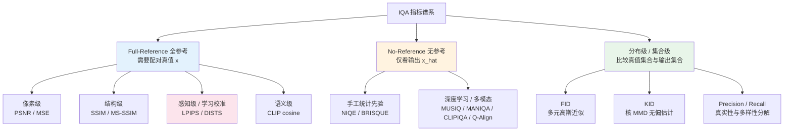
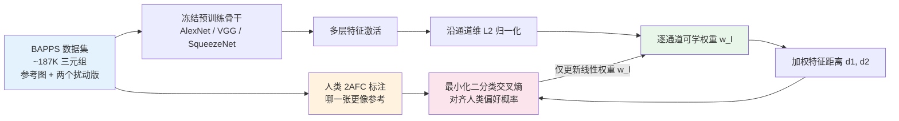
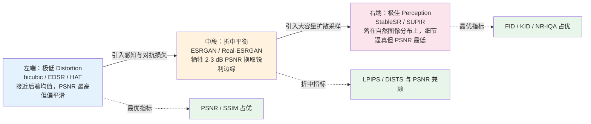

# 第 4 章 · 评估的陷阱

> 影像增强领域有一个公开的秘密：论文表格里最好看的数字，和人眼看起来最舒服的画面，经常对不上。
>
> 这不是因为有人篡改数据，而是因为各类评估指标本身就代表着不同的数学立场。

## 4.0 读这一章之前

第 3 章讨论了训练时的损失函数，也就是“训练时把模型朝哪个方向推”；这一章讨论训练完成后的评估指标，即“用什么尺子衡量模型推得好不好”。这两件事表面上对称，工程约束却截然不同：训练损失必须处处可微、梯度平稳；而评估指标不需要可微，它唯一的核心诉求是**读数高低要尽可能与人类主观判断以及真实业务目标一致**。

读完这一章，你应当能清楚回答这些问题：

- 为什么简单的 bicubic 插值在 PSNR 和 SSIM 上常常能赢过 ESRGAN 与扩散模型，肉眼看起来却最糊
- 全参考（FR）、无参考（NR）与分布级指标这三种评估范式各自适用什么场景
- LPIPS 相比普通 VGG 特征距离，它的“人类感知校准”具体是怎么训出来的
- 为什么在几百张小测试集上报告 FID 毫无统计意义
- 看到一篇论文的实验对比表时，如何一眼识别出指标选择偏差与测试集偏差

本章预设你已了解第 1 章的不适定逆问题、第 2 章的特征空间表征以及第 3 章的感知与对抗损失。

**本章首次出现的缩写。** 前三章已介绍过的术语不再重复，本章新增的缩写包括：

- **FR-IQA**（Full-Reference IQA，全参考图像质量评估）：将模型输出 $\hat{x}$ 与高清真值 $x$ 逐张配对比较，输出相似度或失真距离
- **NR-IQA**（No-Reference IQA，无参考图像质量评估）：无需参考真值，只看单张输出图像 $\hat{x}$ 自身给出质量评分，也称 blind IQA
- **RR-IQA**（Reduced-Reference IQA，部分参考图像质量评估）：仅使用真值图像的部分统计特征作为参照，实际工程较少使用
- **MS-SSIM**（Multi-Scale SSIM，多尺度结构相似度）：在多个下采样尺度上分别计算 SSIM 后加权综合
- **AlexNet**：2012 年提出的经典卷积网络，因其浅中层特征与人类低层视觉响应契合度高，是 LPIPS 评估模式下的默认骨干
- **BAPPS**（Berkeley-Adobe Perceptual Patch Similarity dataset）：LPIPS 论文构建的大规模人类视觉偏好数据集，用于拟合各层特征通道的感知权重
- **2AFC**（Two-Alternative Forced Choice，二选一强制选择）：主观评测的标准范式，给受试者两张结果图，强制选出更好或更接近参考图的一张
- **JND**（Just Noticeable Difference，最小可觉察差异）：人眼刚好能分辨出两张图存在差异的临界阈值
- **MOS**（Mean Opinion Score，平均主观意见分）：多位受试者按固定量表（如 1-5 分）独立打分后的平均值
- **FID**（Fréchet Inception Distance）：在 Inception-V3 特征空间中用多元高斯分布近似真值集与生成集，计算两个分布之间的 Fréchet 距离
- **KID**（Kernel Inception Distance）：在 Inception 特征空间基于核最大均值差异（MMD）计算分布距离，小样本下无偏且比 FID 更稳定
- **NIQE**（Natural Image Quality Evaluator）：基于自然场景统计（NSS）特征偏离度的经典无参考指标
- **BRISQUE**（Blind/Referenceless Image Spatial Quality Evaluator）：基于空域局部归一化亮度统计与支持向量回归的无参考指标
- **MUSIQ**（Multi-Scale Image Quality Transformer）：支持原生多尺度分辨率输入的 Transformer 无参考质量评分网络
- **MANIQA**（Multi-dimension Attention Network for IQA）：结合通道与空间多维注意力的无参考质量评估网络，在生成伪影评估上表现突出
- **CLIPIQA**（CLIP-based IQA）：利用 CLIP 测量图像与“good photo / bad photo”等正负提示词对的余弦相似度来打分
- **PIPAL / KonIQ-10k / SPAQ / LIVE / TID2013**：IQA 领域常用的公开人类主观评分数据集

在展开具体公式前，我们先按“评估时需要什么输入”把整个 IQA 指标家族画成一张分类树：



图中三条主干区别很清楚：全参考（FR）必须拿 $\hat{x}$ 和配对的 $x$ 一对一比；无参考（NR）只看 $\hat{x}$ 自己；分布级指标则不看单张配对，而是比较整个输出集合 $\{\hat{x}_i\}$ 与真值集合 $\{x_i\}$ 的分布距离。下面 4.1 到 4.7 节依次拆解这些指标，4.8 节再揭示它们之间不可调和的数学张力。

## 4.1 一个矛盾的现象

假设在一个包含上千张退化猫脸图像的测试集上，我们分别用三种方法做 4× 超分辨率重建，并在整个测试集上汇总平均 PSNR、SSIM、LPIPS 以及集合级的 FID：

- **方法 A**：直接做 bicubic 双三次插值上采样
- **方法 B**：ESRGAN（经典的对抗生成超分模型）
- **方法 C**：SUPIR（基于大型潜空间扩散先验的超分模型）

跑出来的典型结果往往是这样的：

| 模型 | PSNR (dB) ↑ | SSIM ↑ | LPIPS ↓ | FID ↓ | 人眼主观观感 |
|------|--------|--------|---------|-------|---------|
| A. bicubic | **28.4** | **0.82** | 0.42 | 78 | 整张脸糊成一团，毫无毛发细节 |
| B. ESRGAN | 26.1 | 0.76 | 0.18 | 22 | 毛发边缘锐利，但局部偶有伪影噪点 |
| C. SUPIR | 24.8 | 0.71 | **0.12** | **8** | 胡须与毛孔极其逼真，但细看毛发走向与原图不完全重合 |

这张表里的矛盾非常扎眼：
- **PSNR 和 SSIM 把最高分颁给了 bicubic**，但人眼一眼就能看出 bicubic 是三者里最模糊、最不可用的；
- **LPIPS 和 FID 把最高分颁给了 SUPIR**，它的 PSNR 却比什么都没学的 bicubic 还要低 3.6 dB；
- 没有任何一个模型能在四项指标上同时胜出。

这绝不是偶然的实验误差，而是必然现象。这一章接下来就讲清楚两件事：第一，每个指标到底在量什么、又对什么失明；第二，为什么“保真度”与“感知质量”在数学上本来就不可能同时达到最优。

## 4.2 PSNR

PSNR（Peak Signal-to-Noise Ratio，峰值信噪比）是图像与视频工程中最古老的全参考指标，早在 20 世纪 80 年代就被广泛用于音视频编解码标准评估。它的定义直接建立在均方误差（MSE）之上：

$$
\text{PSNR}(\hat{x}, x) = 10 \log_{10} \left( \frac{\text{MAX}^2}{\text{MSE}(\hat{x}, x)} \right)
$$

其中 $\text{MAX}$ 是像素信号的最大可能取值（归一化浮点数下为 $1.0$，8 位整数下为 $255$），单位是分贝（dB），数值越大表示逐像素平方误差越小。每提升 $3\text{ dB}$，意味着均方误差 MSE 减半。

```python
import torch

def psnr(pred: torch.Tensor, target: torch.Tensor,
         data_range: float = 1.0) -> torch.Tensor:
    """PSNR (Peak Signal-to-Noise Ratio)。
    pred, target: (B, C, H, W), 假设值域为 [0, data_range]
    返回: (B,) 每张图的 PSNR (dB)
    """
    mse = ((pred - target) ** 2).flatten(1).mean(dim=1)
    return 10 * torch.log10((data_range ** 2) / (mse + 1e-12))
```

### PSNR 在量什么、漏了什么

PSNR 唯一度量的就是**逐像素的 L2 欧氏距离**。因为完全不考虑空间邻域结构，它对人类视觉系统高度敏感的几个维度存在盲区：

- **无法区分结构性模糊与随机微扰**：全图均匀涂抹掉高频纹理，和在原图上叠加肉眼几乎不可察觉的微弱颗粒感，可能算出完全相同的 PSNR，但人眼对模糊的厌恶程度远高于微弱颗粒。
- **对亚像素几何位移极度过敏**：如果复原图像与真值图像在空间上哪怕整体错位了 1 个像素，人眼根本看不出任何画质下降，但所有边缘处的像素差都会飙升，导致 PSNR 暴跌好几个分贝。
- **宁可奖励模糊均值，也不宽容锐利相位偏差**：当模型生成了逼真的草叶或毛孔纹理，只要具体一根草叶的像素位置与真值差了半个周期，一正一负相减平方就会产生双倍惩罚（double penalty）；反倒是把草地糊成一片绿泥的保守模型能拿到更高的 PSNR。

### 为什么 PSNR 依然是必报基线

既然 PSNR 在感知上这么迟钝，为什么今天所有论文和工程报告依然必报 PSNR？因为它有几个不可替代的工程优点：
- **计算极快、零外部依赖**：一行张量减法加平方均值即可算出，没有任何预训练网络权重版本不一致的问题。
- **物理含义确定、对低频失真诚实**：如果模型出现了整体色偏、亮度漂移或大面积结构坍塌，PSNR 一定会立刻报警。
- **几十年积累的跨代参照系**：全行业工程师对 PSNR 的数值区间都有共同体感（例如在 4× 超分或中等去噪上，25 dB 以下通常有明显失真，28-32 dB 是主流区间，35 dB 以上肉眼几乎难辨差异）。

在实际工程中比对不同论文的 PSNR 数字时，有一个极易踩坑的细节必须核对：**到底是在 RGB 三通道上算的 PSNR-RGB，还是转成 YCbCr 后只在亮度通道 Y 上算的 PSNR-Y，以及有没有裁掉图像四周的 `scale` 个边界像素（shave border）**。传统学术超分基准（Set5 / Set14 / BSD100）的历史惯例是先裁掉四周 `scale` 像素，再在 ITU-R BT.601 标准转换的 Y 通道上计算 PSNR-Y；它与直接调 `pyiqa` 或 `torchmetrics` 在全图 RGB 上算出的 PSNR 往往相差 **1.0 ~ 2.0 dB**。拿不同口径算出来的数字直接比高低，是复现论文时最常见的乌龙。

一句话总结 PSNR：**它衡量的是“每个像素数值有多接近”，而不是“画面看起来有多清楚”**。

## 4.3 SSIM 系列

### SSIM

为了弥补 PSNR 完全无视局部结构的缺陷，Wang 等人在 2004 年提出了 **SSIM**（Structural Similarity，结构相似度）。它在一个滑动局部窗口（通常为 $11 \times 11$ 的高斯加权窗口）内，分别比较两张图的局部均值（亮度 $l$）、局部标准差（对比度 $c$）和局部协方差（结构 $s$）：

$$
\text{SSIM}(x, y) = \frac{(2\mu_x \mu_y + C_1)(2\sigma_{xy} + C_2)}{(\mu_x^2 + \mu_y^2 + C_1)(\sigma_x^2 + \sigma_y^2 + C_2)}
$$

最后将所有局部窗口的得分取全图平均，取值范围在 $[0, 1]$ 之间，越接近 $1$ 表示结构越相似。

```python
import torch
import torch.nn.functional as F

def gaussian_window(window_size: int, sigma: float) -> torch.Tensor:
    coords = torch.arange(window_size).float() - window_size // 2
    g = torch.exp(-(coords ** 2) / (2 * sigma ** 2))
    g = g / g.sum()
    window = g.unsqueeze(0) * g.unsqueeze(1)
    return window  # (W, W)


def ssim(pred: torch.Tensor, target: torch.Tensor,
         window_size: int = 11, sigma: float = 1.5,
         data_range: float = 1.0) -> torch.Tensor:
    """SSIM 简化实现。生产环境建议统一调用 pyiqa 或 torchmetrics。
    pred, target: (B, C, H, W), 值域 [0, data_range]
    """
    C1 = (0.01 * data_range) ** 2
    C2 = (0.03 * data_range) ** 2
    C = pred.shape[1]

    win = gaussian_window(window_size, sigma).to(pred)
    win = win.expand(C, 1, window_size, window_size)

    mu_x = F.conv2d(pred,   win, padding=window_size // 2, groups=C)
    mu_y = F.conv2d(target, win, padding=window_size // 2, groups=C)
    mu_x2, mu_y2, mu_xy = mu_x ** 2, mu_y ** 2, mu_x * mu_y

    sigma_x2 = F.conv2d(pred * pred,     win, padding=window_size // 2, groups=C) - mu_x2
    sigma_y2 = F.conv2d(target * target, win, padding=window_size // 2, groups=C) - mu_y2
    sigma_xy = F.conv2d(pred * target,   win, padding=window_size // 2, groups=C) - mu_xy

    num = (2 * mu_xy + C1) * (2 * sigma_xy + C2)
    den = (mu_x2 + mu_y2 + C1) * (sigma_x2 + sigma_y2 + C2)
    return (num / den).flatten(1).mean(dim=1)
```

### MS-SSIM

单尺度 SSIM 的结果受滑动窗口尺寸与图像观看距离影响较大。**MS-SSIM**（Multi-Scale SSIM）将图像连续下采样 4 次，在 5 个尺度上分别计算对比度与结构项，在最粗尺度上计算亮度项，最后按经验指数加权相乘。它在视频编码与超分辨率评估中比单尺度 SSIM 更稳健，计算开销也依然很低。

### SSIM 的局限

尽管引入了局部二阶统计量，SSIM 在本质上仍然属于像素域信号保真指标（在 Blau-Michaeli 框架下与 PSNR 同处 distortion 端）：
- **依然偏爱平滑模糊**：轻微模糊对 $11 \times 11$ 窗口内的均值改变极小、对方差的削弱也有限，因此模糊图的 SSIM 往往依然很高（见 4.1 节表中 bicubic 拿到 0.82，而锐利的 SUPIR 只有 0.71）。
- **无法识别语义级纹理好坏**：由于只看一阶均值与二阶方差，它分不清局部窗口里的方差到底是来自逼真的毛孔纹理，还是来自轻度的高频振铃。
- **实现口径碎片化**：不同代码库里 `window_size`（7 还是 11）、高斯核还是均匀核、是否在 Y 通道计算、边界 padding 方式的细微差异，就能让 SSIM 读数相差 `0.01 ~ 0.03`，横向对比时必须锁定同一评测脚本。

## 4.4 LPIPS

2018 年 Zhang 等人提出的 **LPIPS**（Learned Perceptual Image Patch Similarity）彻底改变了低层视觉的评估方式。它不再试图用手工数学公式去猜测人眼怎么看图，而是直接用深度特征加人类主观数据做拟合：

1. 将参考图 $x$ 与预测图 $\hat{x}$ 送入预训练卷积骨干（AlexNet、VGG-16 或 SqueezeNet），提取 $L$ 个中间层的特征图
2. 在每个空间位置 $(h, w)$ 上沿通道维做单位 L2 归一化，记为 $\hat{F}_l(x)_{h,w}$
3. 用一组学习出来的通道权重向量 $w_l$ 对特征差做加权平方和，再在空间维取平均：

$$
\text{LPIPS}(x, \hat{x}) = \sum_l \frac{1}{H_l W_l} \sum_{h, w} \| w_l \odot (\hat{F}_l(x)_{h,w} - \hat{F}_l(\hat{x})_{h,w}) \|_2^2
$$

第 3 章的朴素 VGG 感知损失相当于把所有通道权重 $w_l$ 硬性设为常数 $1$；而 LPIPS 的 $w_l$ 是在 **BAPPS** 数据集的约 18.7 万组人类二选一（2AFC）判断样本上专门训练出来的。校准流程如下图所示：



在 BAPPS 校准训练中，骨干网络本身完全冻结，只优化线性权重 $w_l$ 和一个极小的前向打分头，让距离更小的那张候选图恰好对应大多数人类标注员选出的那一张。由于 BAPPS 涵盖了传统模糊、噪声、压缩失真以及各类 CNN 超分/去噪伪影，LPIPS 对模糊、振铃和塑料感平滑的敏感度远超 PSNR 和 SSIM。

```python
import lpips  # pip install lpips

# 评估时推荐使用 net='alex' (与人眼相关性最高且速度快)
# 若作为训练损失反传梯度, 则推荐 net='vgg'
loss_fn_alex = lpips.LPIPS(net='alex')

def lpips_distance(pred: torch.Tensor, target: torch.Tensor,
                   loss_fn: lpips.LPIPS) -> torch.Tensor:
    """计算 LPIPS 感知距离。
    输入: [0, 1] 范围的 RGB 张量, shape (B, 3, H, W)。
          注意官方 lpips 接口要求输入归一化到 [-1, 1]!
    返回: (B,) 每张图的 LPIPS 距离 (越小表示感知上越接近)
    """
    return loss_fn(pred * 2 - 1, target * 2 - 1).flatten()
```

### LPIPS 的盲区与使用注意

LPIPS 是目前最通用的全参考感知指标，但也有四个必须留意的盲区：
- **不同骨干网络的读数不可互比**：`lpips(net='alex')` 与 `lpips(net='vgg')` 算出的数值尺度相差很大，写报告或对标论文时必须注明使用的是 AlexNet 还是 VGG 版本（学术界默认评估报 `alex` 版）。
- **会被针对性对抗优化欺骗**：如果把 LPIPS 直接放进训练损失里赋予高权重，生成器会学会在画面里织入肉眼看着像细麻点、却能让 AlexNet/VGG 特征差异常变小的对抗纹理。因此**切忌把正在用作训练损失的同一个网络直接当唯一裁判**。
- **对低频整体偏色不够敏感**：因为特征提取前做了标准化且深层关注纹理边缘，画面整体轻微偏暖或饱和度偏低时 LPIPS 可能变化很小，需要靠 PSNR 或色彩指标兜底。
- **仍要求空间位置大致对齐**：因为公式里是逐个空间坐标 $(h, w)$ 相减，对于生成式模型合成出的错位纹理（如草叶或发丝位置与原图不同），LPIPS 仍会给出一定惩罚。

## 4.5 DISTS

为了解决 LPIPS 对纹理空间位置过于苛刻的问题，Ding 等人在 2020 年提出了 **DISTS**（Deep Image Structure and Texture Similarity）。

DISTS 的设计非常巧妙：它同样提取 VGG 的多层特征图，但不再逐像素相减算 L2，而是仿照 SSIM 的形式，在每一层特征图上分别计算两项：
- **结构项（Structure）**：通过特征图的空间协方差衡量边缘与几何布局是否对齐；
- **纹理项（Texture）**：通过特征图的全局空间均值来衡量纹理响应强度是否一致，**完全抛弃了纹理特征的具体空间坐标约束**。

这一点非常贴合人类看自然纹理的习惯：当你看一片草坪、一头卷发或一面粗糙的石墙时，你根本不会去数第 35 根草叶是不是长在原图的 $(x, y)$ 坐标上，你只看整片草坪的质感、密度和粗细跟真值对不对得上。

```python
import pyiqa  # pip install pyiqa

dists_metric = pyiqa.create_metric('dists', as_loss=False)

def dists_distance(pred: torch.Tensor, target: torch.Tensor) -> torch.Tensor:
    """DISTS 距离, 输入值域 [0, 1], 越小越好。"""
    return dists_metric(pred, target)
```

因此，在 comparing 传统判别式模型与 GAN/扩散等生成式复原模型时，DISTS 与 LPIPS 构成了很好的互补：LPIPS 要求“每个局部位置的感知特征都要对得上”，而 DISTS 允许“大结构对齐的前提下，局部纹理按相同统计分布自由重新合成”。

## 4.6 FID / KID

前面介绍的 PSNR、SSIM、LPIPS、DISTS 全部属于**全参考（點对点配对）指标**：拿第 $i$ 张预测图 $\hat{x}_i$ 和第 $i$ 张真值图 $x_i$ 一对一算距离，最后求平均。

但进入生成式增强（特别是重度退化下的扩散超分、老照片修复、盲人脸修复）后，点对点比较遇到了根本困难：输入退化得太厉害，真值图 $x_i$ 上的高频细节早已彻底丢失，生成模型从后验分布 $p(x \mid y_i)$ 中采样出了一张细节生动逼真、但毛孔和细纹具体排布与 $x_i$ 不同的图片 $\hat{x}_i$。这时除了问“$\hat{x}_i$ 与 $x_i$ 像不像”，我们还需要问另一个集合级的问题：

> 模型生成出来的这一大批复原图像 $\{\hat{x}_i\}$，作为一个整体分布，到底像不像真实的自然高清图像分布 $\{x_i\}$？

回答这个分布级问题的标准工具就是 **FID** 与 **KID**。

### FID（Fréchet Inception Distance）

Heusel 等人（2017）提出的 FID 把真值图像集合 $R = \{x_i\}$ 与生成图像集合 $G = \{\hat{x}_i\}$ 分别送入预训练的 Inception-V3 网络，取出最后池化层的 2048 维特征向量。接着，它假设这两组 2048 维特征各自服从多元高斯分布 $\mathcal{N}(\mu_R, \Sigma_R)$ 与 $\mathcal{N}(\mu_G, \Sigma_G)$，并计算两个高斯分布之间的 Fréchet 距离（即 2-Wasserstein 距离）：

$$
\text{FID}(R, G) = \|\mu_R - \mu_G\|_2^2 + \text{tr}\!\left(\Sigma_R + \Sigma_G - 2(\Sigma_R \Sigma_G)^{1/2}\right)
$$

```python
import pyiqa
fid_metric = pyiqa.create_metric('fid')
# FID 是集合对集合的指标, 输入为两个图像目录的路径:
# score = fid_metric(real_image_dir, restored_image_dir)
```

### FID 的常见误用与小样本陷阱

在阅读或撰写增强论文时，FID 是被误用得最严重的指标之一。最典型的错误写法是：

> “我们在 Set14（14 张图）或 RealSR 测试集（100 张图）上测试了 FID，本方法比基线降低了 5.2……”

为什么这样报出来的 FID 没有统计意义？原因在于公式里的协方差矩阵 $\Sigma_R, \Sigma_G$ 是一个 **$2048 \times 2048$** 的大矩阵！用 100 个样本去估计 2048 维空间的协方差矩阵，矩阵是严重秩亏的，不仅方差极大，而且存在系统性的**正偏差**（样本越少，算出来的 FID 虚高得越厉害）。

工程上使用分布级指标必须遵守三条铁律：
1. **样本量门槛**：算整图 FID 至少需要 **5,000 ~ 10,000 张**图像（在超分测试集只有几百张大图时，标准变通做法是从每张大图上随机或网格裁剪出数万个固定尺寸的局部 patch 来计算 **Patch-FID**，并且严格固定 patch 尺寸与总数量）。
2. **严禁跨样本量对比**：5,000 张图算出的 FID 和 50,000 张图算出的 FID 绝对不能直接比大小。
3. **小样本下改用 KID**：**KID**（Kernel Inception Distance）不依赖高斯分布协方差估计，而是用多项式核计算最大均值差异（MMD）的无偏估计，在几百到几千个样本的规模下依然无偏且方差小得多。

顺便解答一个常见疑问：为什么都到 2026 年了，大家算 FID 还在用 2015 年的 Inception-V3，而不是换用更强的 CLIP 或 DINOv2？这是因为学术基准的“历史锁定效应”：一旦换掉特征提取网络或 resize 插值实现（必须用 `clean-fid` 统一的双三次抗锯齿缩放），算出来的数字就与过去八年所有论文彻底不可比了。近年来社区也提出了基于 CLIP 或 DINOv2 特征的 **CLIP-FID** 与 **CMMD**（它们对现代扩散模型的纹理失真更敏感），工程团队在内部评测时可以同时监控传统 FID 与 CMMD，对外发论文则保留标准 `clean-fid` 口径。

## 4.7 无参考指标（NR-IQA）

在真实业务线上，用户随手上传一张模糊暗淡的手机照片，系统手里根本没有对应的“高清真值原图” $x$。此时全参考指标（PSNR、SSIM、LPIPS、DISTS）全部无法计算，唯一能用的是**无参考图像质量评估**（No-Reference IQA，简称 NR-IQA）。

主流 NR-IQA 指标经历了三代演进：

- **第一代：手工自然场景统计（NSS）**，代表是 **NIQE**（2013）和 **BRISQUE**（2012）。它们不需要在带人工评分的数据集上做深度学习训练，而是直接统计图像的局部归一化亮度系数分布与高质量自然图像先验分布的偏离程度。NIQE 越小代表越接近自然统计规律。
- **第二代：深度回归网络**，代表是 **MUSIQ**（2021，多尺度 ViT）和 **MANIQA**（2022，多维注意力网络）。它们在 KonIQ-10k、SPAQ、PIPAL 等带有人类主观打分（MOS）的数据集上训练，直接预测单张图像的主观质量分（数值越大越好）。
- **第三代：多模态与大模型对齐**，代表是 **CLIPIQA**（2023，计算图像与正负质量形容词的 CLIP 余弦相似度）与 **Q-Align**（2024，利用多模态大模型按离散等级分布做视觉质量与美学评分）。

```python
import pyiqa

niqe   = pyiqa.create_metric('niqe',   device='cuda')
musiq  = pyiqa.create_metric('musiq',  device='cuda')
maniqa = pyiqa.create_metric('maniqa', device='cuda')
clipiqa = pyiqa.create_metric('clipiqa', device='cuda')

# 注意方向: NIQE 越小越好; MUSIQ / MANIQA / CLIPIQA 越大越好
@torch.no_grad()
def assess_no_reference(image: torch.Tensor) -> dict:
    """对单张 [0, 1] 图像给出多项无参考质量评估。"""
    return {
        'niqe':    niqe(image).item(),
        'musiq':   musiq(image).item(),
        'maniqa':  maniqa(image).item(),
        'clipiqa': clipiqa(image).item(),
    }
```

### 无参考指标的致命软肋：极易被“刷分”且不管保真

使用 NR-IQA 时必须时刻保持警惕，因为它有两个天然局限：

1. **完全不知道输出跟输入是不是同一张图**：NR-IQA 只看输出 $\hat{x}$ 自己长得好不好看。如果扩散模型把一位满脸皱纹的老人修成了一位皮肤紧致的陌生年轻人，或者把模糊招牌上的文字完全改成另一串清晰但错误的字母，NIQE、MUSIQ、CLIPIQA 都会给出极高的满分，但在业务上这是严重的失真事故。
2. **极易被生成伪影欺骗（Reward Hacking）**：无论是基于固定统计公式的 NIQE，还是基于神经网络的 MANIQA / CLIPIQA，都有各自的偏好漏洞。比如过度锐化的边缘、高对比度的假纹理，或者针对 NR-IQA 反向传播微调出来的特定高频图案，能轻易把 NR-IQA 分数刷到超过真实高清原图，而人眼一看却觉得假得刺眼。

因此，工程上使用 NR-IQA 有两条硬性纪律：
- **永远多项组合报告**（例如同时看 NIQE + MUSIQ + MANIQA + CLIPIQA），并 반드시搭配一项度量输入输出结构一致性的全参考/低频保真指标；
- **绝不单独用某一个 NR-IQA 指标做模型选型或作为强化学习/微调的唯一奖励信号**。

## 4.8 保真 vs 感知：一个理论必然

现在我们可以回到 4.1 节开头那张矛盾的表格了：为什么 bicubic 拿了最高的 PSNR/SSIM，而 SUPIR 拿了最好的 FID/LPIPS？能不能训练出一个既拿最高 PSNR、又拿最好 FID 的全能模型？

Blau 与 Michaeli 在 2018 年的奠基性论文 *"The Perception-Distortion Tradeoff"* 中给出了严格的数学证明：**不能**。

定理的核心结论是：

> 对于不适定（ill-posed）逆问题，**失真度**（Distortion，即 $\mathbb{E}[\Delta(x, \hat{x})]$，指需要拿预测图 $\hat{x}$ 与配对真值 $x$ 逐对计算的期望误差）与**感知散度**（Perception index，即 $d(p_{\hat{x}}, p_x)$，指预测图像的边缘分布 $p_{\hat{x}}$ 与真实自然图像分布 $p_x$ 之间的分布散度）**在数学上不可能同时达到最优**。
>
> 当要求感知散度 $d(p_{\hat{x}}, p_x) \to 0$（即输出 100% 符合真实自然图像分布）时，其所能达到的最小均方误差（MSE）下界是全局最小均方误差（MMSE）的 **2 倍**（对应 PSNR 至少下降约 **3 dB**）。

这里有一个概念边界值得专门点破：虽然日常交流中大家常把 LPIPS 叫作“感知指标”，但在 Blau-Michaeli 定理的严格数学定义里，**LPIPS 和 DISTS 依然属于 Distortion（失真度量）一侧**，而**只有 FID、KID、NIQE 这类不依赖 $(x, \hat{x})$ 配对的分布距离才属于 Perception（感知散度）轴**。划分两者的标准不是“用不用深度网络”，而是“算分时要不要拿预测图跟真值图一对一配对”。LPIPS 之所以比 PSNR 更倾向于奖励清晰模型，是因为它换了一个更贴合人类视觉的失真度量函数 $\Delta(x, \hat{x})$，使得失真-感知权衡曲线变得更平缓，但它本质上仍在衡量配对失真。

为什么均方误差最优（低 Distortion）与分布一致（高 Perception）必然冲突？用一句话就能建立几何直觉：
- **最小化 MSE 的最优解**是后验均值 $\hat{x}_{\text{MMSE}} = \mathbb{E}[x \mid y]$。因为自然图像流形是高度非凸的弯曲曲面，流形上多个合理样本点的算术平均值，一定会掉到流形外面的空白区域里，表现出来就是模糊。
- **最小化分布散度（FID $\to 0$）**则要求每个输出 $\hat{x}$ 必须老老实实落在自然图像流形曲面上（例如从后验分布 $p(x \mid y)$ 中随机采样一个点 $\hat{x}_{\text{sample}}$）。既然是在流形上采样出来的具体点，它与流形上另一个未知的真实点 $x$ 之间的期望欧氏距离平方 $\mathbb{E}[\|\hat{x}_{\text{sample}} - x\|^2]$，恒等于两倍的后验方差，也就是后验均值误差 $\mathbb{E}[\|\hat{x}_{\text{MMSE}} - x\|^2]$ 的整整两倍！

把不同时代的代表模型放在这条 **Perception-Distortion（P-D）权衡曲线** 上，各自的位置一目了然：



这条曲线给出了三条直接指导工程选型的结论：
1. **保真派与生成派指标打架是数学铁律**，永远不要指望同一个模型在 PSNR 和 FID 上同时击败所有对手。
2. **对比模型时必须先看它们站在曲线的哪一端**：拿主打高 PSNR 的 HAT 和主打生成质量的 SUPIR 直接比单个指标毫无意义，它们优化的根本不是同一个目标。
3. **业务容忍度决定了你该选曲线上的哪个点**：车牌取证、医学影像和文字 OCR 必须死守左端（宁可糊，绝不编造）；老照片修复、壁纸放大和影楼人像精修则应当走向右端（用像素级微偏换取逼真的主观质感）。

## 4.9 Benchmark 数据集的系统性偏差

读论文实验表时，除了看用了什么指标，更要看是在**哪个测试集**上跑出来的数字。学术界沿用了十几年的标准测试集，与真实工业生产环境之间存在着巨大的鸿沟。

### 经典学术超分测试集

| 数据集 | 图像数量 | 内容特点 | 主要偏差与局限 |
|-------|---------|------|------|
| Set5 | 5 | 婴儿、鸟、蝴蝶等特写 | 样本量极小，单张图表现好坏就能左右平均分 |
| Set14 | 14 | 人物、斑马、漫画等杂图 | 样本量太小，统计方差大 |
| BSD100 | 100 | 经典自然风景与物体 | 分辨率偏低，年代久远（2001 年） |
| Urban100 | 100 | 城市建筑外立面、百叶窗、网格 | 富含规则重复几何结构，极度利好自注意力与非局部模型 |
| Manga109 | 109 | 日本黑白漫画页面 | 纯人工绘制线条与网点，与自然相机成像统计完全不同 |
| DIV2K val | 100 | 2K 高清摄影图 | 画质极佳、光照充足，缺乏真实手机弱光与压缩噪点 |
| LSDIR val | 250 | 大规模多样化高清图 | 覆盖面更广，但默认测试仍基于合成下采样 |

### 经典测试集的两大共性陷阱

第一，**退化模型单一且已知**：上面所有经典测试集的低分辨率输入，默认全是用干净高清图直接做理想 **bicubic 下采样** 生成的。如第 1.7 节所述，这意味着训练与测试都在同一个理想温室里打转。一个专门针对 bicubic 逆核过拟合的模型，在 Set5 和 Urban100 上能刷出惊人的 PSNR，但一碰到带传感器噪点和微信 JPEG 压缩的真实手机图片就会彻底失效。

第二，**图像内容高度美化**：DIV2K、BSD100 里的原图大多是单反相机在良好光照下拍摄的摄影作品。而真实业务里用户上传的图片，充斥着暗光室内照、逆光运动抓拍、带屏幕摩尔纹的翻拍照以及经年累月褪色的老照片。

### 真实世界配对测试集（Real-World Benchmarks）

为了评估盲复原模型在真实退化下的表现，研究者构建了几套真实拍摄或复杂退化测试集：
- **RealSR**（2019）与 **DRealSR**（2020）：用同一台单反相机架在三脚架上，分别用长焦端（拍 HR 真值）和广角端（拍 LR 输入）拍摄同一静态场景，再通过亚像素配准对齐。
- **DPED**（2017）：同步使用低端智能手机与专业单反相机拍摄同一场景。
- **SIDD / DND**（真实去噪）：固定机位下用高 ISO 短曝光拍摄真实噪点图，用低 ISO 多帧长曝光平均生成干净真值图。

需要注意的是，即便是 RealSR 和 DRealSR，它们的“真实退化”也只是单反镜头不同焦段的光学差异，并没有包含手机小底传感器暗光噪点、ISP 涂抹和社交平台多次重压缩；而且哪怕经过配准，长焦与广角之间依然存在微小的视差与几何畸变，这会让逐像素对齐的 PSNR 读数天然受限。

因此，在工业界做算法落地时，公开数据集（DIV2K + RealSR）只用来做底线回归（确认模型基础能力没训崩），**真正决定模型能否上线的，一定是团队从自身业务真实用户流量里抽样构建的几百张黄金业务回归集（Golden Set）**。

## 4.10 训练与验证时应该监控什么

在日常训练循环中，验证（validation）步骤该怎么配指标？

**每次验证必跑的轻量组合（每 5K 步）**：
- **PSNR + SSIM**：监控低频保真度与结构稳定性，确认没有发生色偏或发散；
- **LPIPS（及 DISTS）**：监控感知清晰度与纹理还原质量；
- **分项训练损失曲线**：像素损失、感知损失、判别器真假得分各自单独画图。

**定期运行的重型或业务评估（每 20K ~ 50K 步或每个大阶段末）**：
- **Patch-FID / KID**：对生成式模型，在大规模验证集（或裁剪出的上万个 patch）上评估分布质量；
- **真实无真值业务集上的 NR-IQA 组合**（NIQE + MUSIQ + MANIQA + CLIPIQA）；
- **固定种子的可视化看板（Visual Dashboard）**：精心挑选 10~20 张涵盖人脸、文字、树叶、暗光噪点、平坦天空等典型难例的固定测试图，每次验证都把输出原图存入 TensorBoard / WandB。**任何指标数字都替代不了算法工程师每隔几万步亲眼放大 200% 看一遍固定样本集**，因为轻微的棋盘格伪影、肤色发蜡或边缘绿边，人眼两秒钟就能抓出来，而平均 PSNR 和 LPIPS 往往毫无反应。

```python
class ValidationMetrics:
    """训练期间的验证集全参考指标封装。"""
    def __init__(self, device='cuda'):
        import pyiqa
        self.psnr  = pyiqa.create_metric('psnr',  device=device, as_loss=False)
        self.ssim  = pyiqa.create_metric('ssim',  device=device, as_loss=False)
        self.lpips = pyiqa.create_metric('lpips', device=device, as_loss=False)
        self.dists = pyiqa.create_metric('dists', device=device, as_loss=False)

    @torch.no_grad()
    def __call__(self, pred: torch.Tensor, target: torch.Tensor) -> dict:
        return {
            'psnr':  self.psnr (pred, target).mean().item(),
            'ssim':  self.ssim (pred, target).mean().item(),
            'lpips': self.lpips(pred, target).mean().item(),
            'dists': self.dists(pred, target).mean().item(),
        }
```

## 4.10b 主观评测：MOS 与 2AFC

无论客观指标怎么演进，影像增强最终服务的都是人眼。当两个模型在客观指标上互有胜负，或者准备把新模型推上生产环境替换旧模型时，**双盲人类主观评测（User Study）** 是最终的裁决手段。

工程上最常用的主观评测协议有两种：

- **MOS（Mean Opinion Score，平均意见分）**：给评测员展示单张图像，让其按 1~5 分（极差到极好）独立打分，最后计算所有评测员在所有测试图上的平均分。优点是可以同时评估任意多个模型并得到绝对质量水位；缺点是不同人对“4 分”和“5 分”的心理尺度不一，个体方差大，必须剔除异常打分并做 Z-score 标准化。
- **2AFC（Two-Alternative Forced Choice，二选一强制对比 / A/B 盲测）**：屏幕左右并排展示同一张退化图经由模型 A 和模型 B 处理后的结果（左右顺序随机打乱，也可在中间放上原图供对照保真度），要求评测员二选一回答“哪一张画质更好且未见失真伪影”。优点是人类做相对比较远比打绝对分数敏锐、一致性高得多；缺点是只能两两PK。

第 12 章会完整展开双盲主观评测的样本量计算、评测员一致性检验（Cohen's $\kappa$ / Krippendorff's $\alpha$）以及统计显著性检验方法。这里先记住一条原则：**在生成式增强时代，任何没有固定案例可视化和双盲主观对比支撑的“客观指标 SOTA”，都不足以作为上线依据**。

## 4.11 论文与技术报告里该怎么报指标

无论你是写学术论文还是写团队内部的立项评测报告，规范的指标组合应当包含：

- **合成配对测试集**：同时报告 **PSNR + SSIM + LPIPS + DISTS**（兼顾保真与感知），如果是生成式模型且样本量充足，加上 **FID / KID**。
- **真实无真值测试集**：同时报告 **3~4 个主流 NR-IQA**（如 NIQE + MUSIQ + MANIQA + CLIPIQA），并附上 **2AFC 主观盲测胜率**。
- **计算代价指标**：参数量（Params）、指定输入尺寸下的乘加计算量（FLOPs / MACs）、实际 GPU/NPU 推理延迟（Latency）与峰值显存占用（Peak VRAM）。

应当主动规避的四类不良报告习惯：
1. 生成式模型只挑对自己有利的 NR-IQA（如只报 CLIPIQA 和 MANIQA），绝口不提 PSNR、LPIPS 等保真指标；
2. 判别式模型只在理想 bicubic 的 Set5 / Set14 上报 PSNR，不测真实退化泛化能力；
3. 在几十张图的小数据集上硬算 FID 并宣称大幅领先；
4. 只挑三四张效果最好的成功案例（cherry-picking），不分析模型在文字、小人脸或密集网格上的典型失败边界。

## 4.12 场景选型：回到 bicubic vs ESRGAN vs SUPIR

把 4.1 节的三个模型放回不同业务场景，我们就能看清“指标立场”如何直接决定工程选型：

| 业务场景 | 容错边界与核心诉求 | P-D 曲线位置 | 优先参考指标 | 推荐模型类型 |
|------|------|------|------|------|
| 司法物证、监控车牌/人脸识别、医学影像 | 绝对禁止无中生有，宁可模糊也不可编造假笔画或假病灶 | 极左端（Distortion 端） | PSNR、SSIM、下游识别准确率 | 判别式回归网络（EDSR / SwinIR / NAFNet） |
| 电商商品图超分、影视母版修复、日常打印放大 | 边缘必须锐利清晰，但商品文字和人物五官不能变样 | 中段偏左至中段 | LPIPS、DISTS + PSNR 兜底 + 人工抽检 | 轻度 GAN 或少步受控扩散（Real-ESRGAN / OSEDiff / StableSR 高保真档） |
| 手机相册“一键高清”、社交平台老照片翻新、AIGC 壁纸放大 | 用户追求第一眼惊艳的毛发与皮肤质感，容忍微观纹理重绘 | 右端（Perception 端） | LPIPS、DISTS、FID、NR-IQA + 2AFC 盲测 | 强生成先验模型（SUPIR / CodeFormer） |

> 问“哪个增强模型最好”是一个伪问题。
> 真正专业的提问是：“我的业务场景能容忍多少生成式幻觉？在失真-感知曲线上，我应该把锚点定在哪里？”

## 4.12b 读到任何一个指标数字时的灵魂四问

下次你在论文、技术博客或供应商评测报告里看到“某模型在测试集上达到 PSNR 32.5 dB / LPIPS 0.11 / FID 9.8”时，不妨先过一遍这四个问题：

1. **它是全参考（FR）、无参考（NR）还是分布级指标？** 如果只报了 NR-IQA 却没报任何配对保真指标，模型有很大概率是通过过度锐化或重绘细节来刷分的。
2. **计算口径对齐了吗？** PSNR/SSIM 是算在 RGB 还是 Y 通道？有没有裁边界？LPIPS 的骨干是 `alex` 还是 `vgg`？输入是归一化到了 `[-1, 1]` 还是误传了 `[0, 1]`？
3. **测试集的退化方式和样本量够格吗？** 是理想 bicubic 还是真实复合退化？算 FID 的样本量够不够上万个 patch？
4. **这个指标奖励的方向跟我的业务目标一致吗？** 我做的是需要逐像素保真的文档/医疗图像，还是需要逼真毛孔的老照片修复？

过完这四问，绝大多数看似矛盾的实验表格都会变得清晰透明。

## 4.13 小结

1. **PSNR 与 SSIM 度量信号保真度**，计算快、对低频色偏诚实，但对模糊过于宽容、对亚像素错位过于敏感，单独看会严重误导主观画质判断。
2. **LPIPS 与 DISTS 在预训练深度特征空间度量感知失真**，经过人类偏好数据校准，远比 PSNR 贴合人眼；其中 DISTS 进一步放宽了局部纹理的位置对齐要求。
3. **FID 与 KID 度量输出集合与真实图像集合的分布距离**，适合评估生成式复原模型，但 FID 必须有上万样本（或上万 patch）支撑，小样本下应改用无偏的 KID。
4. **NR-IQA（NIQE / MUSIQ / MANIQA / CLIPIQA）** 是真实无真值场景的必备工具，但完全不考核与输入的一致性，且极易被针对性伪影刷分，必须多项组合并配合保真约束使用。
5. **失真-感知权衡（Perception-Distortion Tradeoff）是信息论定理**：低失真（高 PSNR）与高感知质量（低 FID）不可兼得，任何模型都是在 P-D 曲线上根据业务需求选点。
6. **评估体系是一个分层结构**：训练期看分项损失 + PSNR/LPIPS + 固定难例可视化看板；模型定型看公开集 + 真实业务黄金集的多维指标；上线前最终裁决看双盲 2AFC / MOS 主观评测。

到这里，我们已经理清了退化逆问题（第 1 章）、表征空间（第 2 章）、训练损失（第 3 章）与评估指标（第 4 章）。Part I 还剩最后一块、也是决定真实场景成败最关键的一块拼图：既然真实世界没有现成的成对 $(x, y)$ 数据，我们究竟该如何合成出逼真的训练数据？这就是下一章的主题。

---

> 下一章：[数据与退化合成](05-degradation-pipeline.md)
